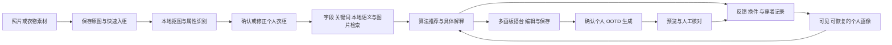
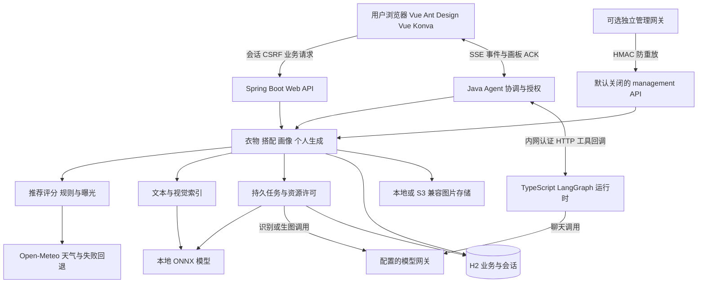
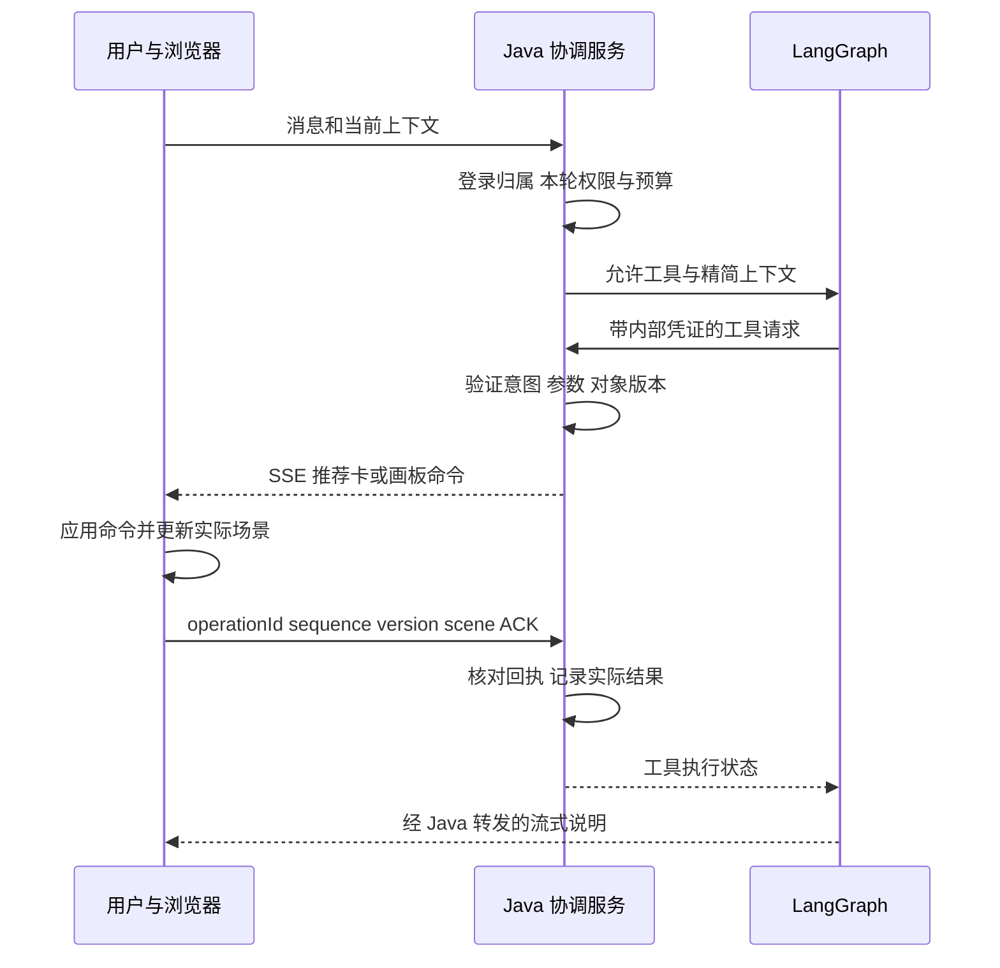
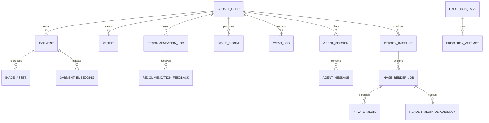

# 核心功能与系统设计

这是按当前实现整理的竞赛版设计，覆盖两个业务仓库与后端 Agent 运行时。详细规则和接口以原始设计、源码及契约为准；本文件不替代原设计的审核与变更流程。

## 1. 系统如何形成闭环？

不同入口共享衣物数据、推荐计算和任务基础设施。用户可以只管理衣柜或使用本地推荐；聊天和生图是增加表达与呈现能力的入口。

## 2. 总体架构如何分工？

图表达逻辑依赖，不表示每个方框都有独立进程。常规部署核心是 Java 服务和 Node Agent 两个进程。模型权重是挂载的本地文件；数据库、锁和删除记录仍有单机边界。

当前推荐计算类复用 `agent.OutfitRules` 的领域分类与结构检查，源码存在从 recommend 到 agent 包的引用。因此只能说“推荐计算独立于远程模型执行”，不能声称包依赖已经完全符合旧设计的隔离目标。

## 3. 关键用户功能怎样设计？

| 功能 | 用户入口 | 关键设计 |
|---|---|---|
| 衣柜与资料 | 衣柜、衣物详情、待确认、回收站 | ACTIVE/DRAFT/TRASHED；自动字段与用户覆盖分离；归属和 revision |
| 快速入柜 | 添加衣物、相机、目标定位 | 稳定上传编号；原图先存；上传即用或基础图就绪两档；增强不阻塞已有成果 |
| 搜索与相似提示 | 衣柜搜索、以图搜图、相似衣物 | 硬字段+关键词+本地向量；模型状态与降级可见；可能重复由用户判断 |
| 智能推荐 | 推荐区、今日灵感、助手 | 意图、两条候选路径、11 维评分、依据、换批/换件、未入选解释 |
| 个人画像 | 设置中的穿搭画像 | 行为/反馈与长期记忆分开；证据、衰减、恢复和清空可见 |
| 多画板搭台 | 搭配库、工作区、推荐卡 | 4:5 场景、多画板、独立历史、图层、等比布局、保存冲突 |
| 平台助手 | 右侧覆盖面板与悬浮球 | 查询/授权操作分组；紧凑卡片、确认操作、执行回执、帮助来源 |
| 个人 OOTD | OOTD、个人设置 | 多模特、保存搭配、免费结构检查、准备确认、冻结参考、生成结果 |
| 动作与调整 | OOTD 动作区、大图面板 | 8 个预设、文字/图片动作卡、五维调整产生新图 |
| 任务与通知 | 任务页、任务收件箱 | 等待原因、分阶段状态、已有成果、取消、可恢复/未知区别 |
| 审核与管理 | 用户端管理员页、可选独立平台 | 模板审核、样本审核、账号、运维、KPI、去标识出口 |
| 安装与跨设备访问 | 设置中的安装应用、浏览器 | PWA 独立窗口、静态外壳缓存；业务联网，本机未保存草稿不跨设备同步 |

依据：[前端路由](../../smart-closet/src/router.ts)、[前端交互说明副本](原始资料/前端/docs/INTERACTION.md)、[产品接口说明副本](原始资料/后端/docs/CLOSET_PRODUCT.md)。用户端的管理员页面与独立管理平台不是同一个应用。

## 4. 入柜为什么需要资产和任务分开？

上传使用稳定请求编号与内容指纹，相同编号和相同内容返回同一结果，内容变化产生幂等冲突。原图资产先保存，再建立工作流和入柜记录；用户可以在后续识别或增强失败时继续使用已有图片。

`BASE_READY` 表示基础图完成后入柜，`UPLOAD_READY` 表示上传后即可使用。目标模糊时可以等待点选/框选；识别资料区分已确认、推测、未知、冲突等状态。透明度和本地质量检查补充模型判断，发现残损时保留原因与修复路径。

数据库保存工作流、步骤、attempt 和图片资产关系，文件层保存原图与派生产物。receipt 等恢复信息用于处理“文件已写出但数据库尚未提交”的窗口。批量路径保留合图、候选、审核与拆分设计，但不承诺每张复杂照片都能自动准确拆出全部衣物。

详细原文：[快速入柜与统一任务架构](<原始资料/后端/docs/design/2026-10-05-快速入柜与统一任务执行架构.md>)、[衣物入库完整设计](原始资料/后端/docs/design/衣物入库最新设计.md)、[图片工作流](原始资料/后端/docs/IMAGE_WORKFLOWS.md)。

## 5. 推荐结果与用户反馈怎么保存？

服务层读取当前用户衣柜、属性与色板、画像、天气和曝光；纯计算引擎接收这些输入，返回结果、维度依据、限制与衣物追踪。模型只在聊天路径理解条件并解释紧凑结果。

推荐缓存按衣柜和意图等上下文维护，常规生命周期约 30 分钟；换一批复用候选并按当前反馈重新核对，换一件重新计算替代品，避免把反馈前的缓存结果机械重复。推荐记录保存当时衣物、得分、规则命中与版本，支持“为什么没推荐那件”和后续统计。

收藏、采用、OOTD、穿着打卡和弱行为形成画像信号，但不能把点击率等同于真实穿着率。明确反馈进入对应粒度，不写进敏感长期记忆。用户能恢复冷却、屏蔽信号、清空偏移或关闭画像。

详细原文：[推荐总设计](原始资料/后端/docs/design/2026-10-08-智能搭配推荐引擎与语义召回设计.md)、[审美实现](原始资料/后端/docs/design/2026-10-10-搭配审美实现设计.md)、[风格画像](原始资料/后端/docs/design/2026-10-10-风格画像设计.md)。

## 6. 助手怎样操作真实界面？

图中 ACK 专指画板操作；只读工具直接返回事实，不需要浏览器 ACK。破坏性操作、批量/覆盖和付费生成有对应确认流程，不能通过聊天历史或帮助文章扩大本轮权限。

画板命令采用 run/session/workspace/board/operation 标识、顺序与预期版本。前端去重；后端验证归属、授权期限和场景；迟到或取消后的回执拒绝。停止并接手保留部分结果，不在刷新后自动续执行。正式保存仍由明确操作完成。

执行追踪记录输入快照、工具结果、规则和客户端回执，并脱敏凭据等内容；它是执行依据，不是模型隐藏思维链。帮助由版本化 Markdown 提供，缺少可靠命中时说明不知道。

详细原文：[Agent 说明](原始资料/后端/docs/AGENT.md)、[搭台设计](原始资料/后端/docs/OUTFIT_WORKSPACE.md)、[平台级助手与 OOTD](原始资料/后端/docs/PLATFORM_AGENT_OOTD.md)。

## 7. OOTD 为什么分为准备和提交？

Frozen 数据包含参考资产/hash、衣物与资料/人物版本、服务商配置 revision、用途能力版本、提示词版本和动作。提交与执行核对变化，避免用户确认后输入悄悄改变。上游是否支持多参考和所选用途必须有能力记录，不只看模型名字。

多个已确认模特可以命名、分别选择默认。名称是标签，不改 revision。动作可用自动、8 个预设或自建卡：图片提取只保留姿势描述和示意关节，不保存动作原图，不把它传给生图；疑似未成年拒收。关节是识图估计，动作主要靠文字约束。

身材调整五维为整体、肩宽、腰围、臀围、腿长，每项 −2…2。它基于原结果生成新图，保留原图，不写回个人资料。提示幅度不是物理测量保证。生成图可能改变袖长、纹理等细节，必须人工核对。

配件推荐只作建议、不改总分；物品穿着方案与画布装饰分开。OOTD 样本抽取只记录衣物组合描述，“好看”由管理员审核，审核结束删除样本原图；衍生模板仍须审核才能生效。

详细原文：[多模特、动作与调整](<原始资料/后端/docs/design/2026-10-12-多模特、OOTD动作与身材调节设计.md>)、[全身穿搭](原始资料/后端/docs/design/2026-10-09-全身穿搭与呈现增强设计.md)、[样本规范](原始资料/后端/docs/OOTD_SAMPLE_COLLECTION.md)。

## 8. 持久数据如何关联？

图为简化逻辑关系，不代表所有关联都有数据库外键，不包括全部表。搭配衣物关系可以在 scene/JSON 中表达。执行任务与业务任务有关联，但二者状态不是同一个对象；资源许可控制实际上游调用。完整 DDL 以 [迁移目录](../src/main/resources/db/migration/h2) 为准。

## 9. 数据和部署边界是什么？

用户端使用 Cookie/JDBC 会话、CSRF 和归属校验；账号初始密码需要更改。通用长期记忆和敏感个人记忆分开，敏感数据按用途授权。推荐不会向模型发送完整衣物资料、性别或身材数据，其他获授权识图/生图流程按用途准备参考。

私有图片经过后端身份与归属检查。本地存储与 S3 兼容存储通过 `BlobStore` 切换；签名直链是限时 bearer 访问能力，不能声称发出后仍需每次登录。画布跨域像素读取有后端转发路径，不能把所有图片请求都描述为直连桶。

management 模块默认关闭，通过 HMAC、时间窗口与 nonce 防重放接入，核心不得依赖该模块。大屏和数仓明细使用 userKey，不输出用户名、衣物名称、图片或聊天；运维管理 API 只读，不提供远程任务重试/取消或改配置。这不影响业务用户端自己的任务操作入口。

源码：[安全配置](../src/main/java/com/smartcloset/security/SecurityConfiguration.java)、[PrivateMedia](../src/main/java/com/smartcloset/person/PrivateMedia.java)、[管理签名](../src/main/java/com/smartcloset/management/auth/HmacManagementAuthenticator.java)、[管理契约副本](原始资料/后端/docs/management-api.yaml)、[存储说明](<原始资料/后端/docs/design/2026-10-11-对象存储（S3兼容·腾讯云COS）设计.md>)。

## 10. 怎样验证设计？

核心验证包含：坏搭配优劣题、规则表完备性、风格反例、搜索空结果、28 天曝光模拟、账号隔离、CSRF、合同与包依赖、请求幂等、任务恢复、图片对拍和画板 ACK。真实模型相关测试按模型/密钥条件运行，模拟上游不能证明真实生成质量。

本轮只扫描并整理已有证据，没有执行上述业务验收。推荐健康度自动学习、权重拟合、完整按用户灰度和专业物理试衣不属于当前已确认交付；详见 [扫描结论](07-扫描结论与证据边界.md)。
