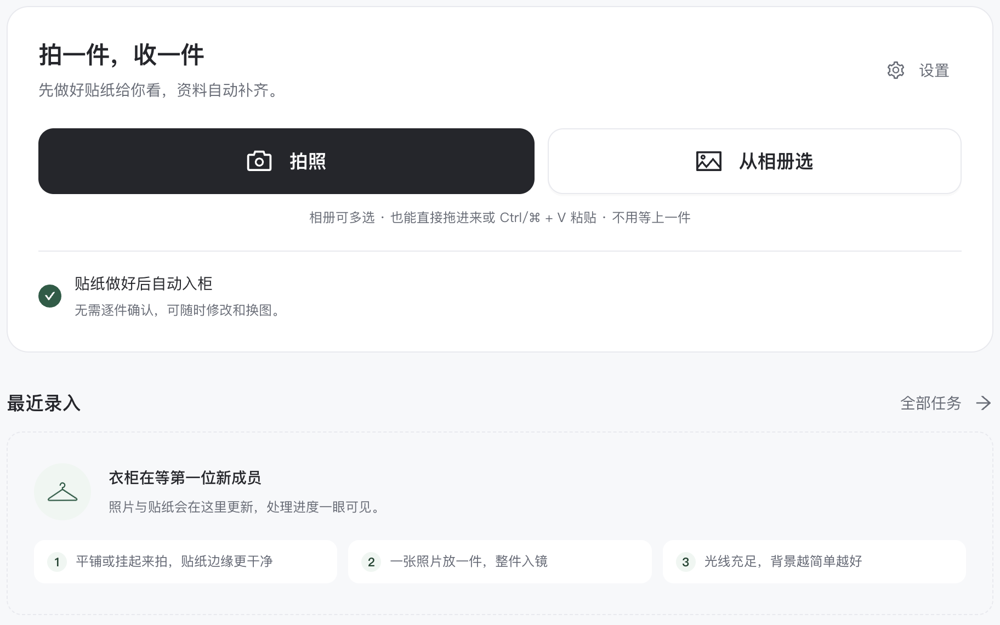

# light-theme-refinement_20261015_20261015_233059

- Source: `light-theme-refinement_20261015_20261015_233059.pptx`
- Total slides: 18

## Slide 1

AI 数字衣柜 · Web 网站

鱼搭

让已有衣物，
成为每天的选择。

参赛团队：鱼力无限
网页作品路演

鱼力无限 / 鱼搭 · AI 数字衣柜网站

01

### Speaker Notes

大家好，我们是鱼力无限团队，带来的网页作品叫鱼搭。它是一个 AI 数字衣柜和穿搭决策网站，从已有衣物出发，让每天的选择更容易理解和调整。

## Slide 2

从真实衣柜，到日常选择

路演目录 / 六个问题，讲清鱼搭

为什么做

产品如何工作

1

2

衣柜很满，选择仍难

入柜 · 推荐 · 搭台 · OOTD

创新与算法

技术如何支撑

3

4

本地检索 · 可解释推荐

Web · 模型 · 持久任务

用户与商业

团队与下一步

5

6

共创验证 · 订阅与额度

鱼力无限 · 作品与规划

鱼力无限 / 鱼搭 · AI 数字衣柜网站

02

### Speaker Notes

这次路演先从用户的日常困境出发，再展示入柜、推荐、组合台与 OOTD 的产品闭环。之后解释创新机制、Web 技术架构和运行边界，最后讨论目标用户、盈利验证、团队能力与下一阶段计划。

## Slide 3

衣柜很满，选择仍然很难

01 · 需求洞察

照片分散、灵感难落地，
出门前仍然反复选择那几件。

今天，适合穿什么？

1

建议有依据

衣物多，难以记忆和查找

2

衣柜可搜索

有灵感，却难用自己的衣物还原

3

组合可编辑

鱼力无限 / 鱼搭 · AI 数字衣柜网站

03

### Speaker Notes

衣柜已经装满，为什么仍不知道穿什么？我们关注三个断点：场景和天气之间很难选择；衣物多而难以记忆、查找和整理；收藏了灵感，也难用自己的衣物还原。鱼搭分别提供建议、衣物记忆和组合辅助，先把这些问题接成日常可执行的流程。这里描述用户情景，不代表已经完成大规模需求调查。

## Slide 4

把衣柜，变成决策资源

01 · 项目立意

从真实衣物出发，让每次选择都有依据。

拥有

理解

选择

反馈

真实衣物

属性与图像

场景 · 天气 · 风格

换件 · 喜好 · 恢复

库存成为起点

知道适合什么

选择附带理由

影响下一次选择

让更多已有衣物进入日常；实际效果仍需用户验证。

鱼力无限 / 项目立意

04

### Speaker Notes

我们把衣柜看成一种决策资源：真实衣物是起点，属性和图像帮助理解，再按场景、天气、风格选择，最后把换件、喜好和恢复反馈带回下一次推荐。每次选择都应有依据，也允许用户接手。让更多已有衣物进入日常是产品目标，实际穿着效果还要用用户研究验证。

## Slide 5

拍一件，收一件

02 · 网站功能 / 快速入柜

拍照或选图

1

相册多选 · 拖拽 · 粘贴

先看到贴纸

2

后台处理，无需原地等待

入柜后可修改

3

资料、图片仍可继续调整

实时网站画面 · 完整操作区

鱼力无限 / 鱼搭 · AI 数字衣柜网站

05

### Speaker Notes

用户可以在网站中拍照、从相册多选，也可以拖拽或粘贴图片。当前快速入柜模式先生成贴纸，资料在后台继续补齐，贴纸做好后自动入柜；用户仍可修改资料和更换图片。这张画面重新截取了完整的操作卡片和说明，展示可运行网站的真实交互。

## Slide 6

从入柜到出门，一个完整闭环

02 · 六步核心功能

1

拍照入柜

2

混合检索

3

计算推荐

照片转成衣物资产

字段 · 文本 · 图像

组合 · 评分 · 理由

6

反馈调整

5

OOTD 预览

4

搭台编辑

偏好可恢复

模特 · 动作 · 调整

多画板，自由接手

OOTD 仅作效果预览；真实合身与细节仍需线下确认。

鱼力无限 / 鱼搭 · AI 数字衣柜网站

06

### Speaker Notes

完整用户链路包含六步：拍照入柜，混合检索，计算推荐，多画板搭台编辑，个人 OOTD 预览，以及反馈调整。检索结合字段、文本和图像，推荐提供组合、评分与理由，搭台允许用户编辑和接手，反馈有粒度也可以恢复。OOTD 支持模特、动作与调整，但只是生成式效果预览，不能证明真实尺码合身或保证衣物细节完全一致。

## Slide 7

先看见价值，再看它如何工作

02 · 视频展示 / 素材制作完成后插入

宣传视频

演示视频

视频待插入 · 16:9

视频待插入 · 16:9

从穿搭困境，到鱼搭的日常价值

入柜 → 推荐 → 搭台 → OOTD

同一页预留两个独立视频位，保留完整画面比例。

鱼力无限 / 鱼搭 · AI 数字衣柜网站

07

### Speaker Notes

这一页预留宣传视频和操作演示两个独立的位置。宣传视频将解释日常穿搭困境和鱼搭的价值；演示视频将串起入柜、推荐、组合台与 OOTD 的操作。当前视频仍在制作，页面中的两个框是待插入位置，正式路演前将替换为实际视频。

## Slide 8

从用户问题，到可解释的实现

03 · 创新机制与用户价值

维度

用户问题

鱼搭机制

持久任务
提交后查看状态

图片处理

上传后还要原地等待

本地抠图 · 属性证据
用户可核对与修正

输入可靠性

背景复杂，属性难确认

规则解释 · 曝光均衡
反馈可恢复

推荐选择

理由不清楚，结果总重复

授权 · 回执 · 额度快照
未知结果不盲目重试

执行与成本

耗时与上游结果不确定

鱼力无限 / 鱼搭 · AI 数字衣柜网站

08

### Speaker Notes

这一页从用户问题解释实现机制，不再对其他产品作未经验证的负面概括。持久任务把提交和耗时处理分开；本地抠图、属性证据和人工核对提高输入可靠性；规则理由、曝光均衡和可恢复反馈支持可解释选择。执行还受授权、回执和额度快照约束，上游结果未知时不会盲目重试。它们是当前项目可追溯的实现特点，不代表已经通过同一协议证明胜过所有竞品。

## Slide 9

照片入柜，三道可靠性工序

03 · 图像处理

1

2

3

图像规整

本地抠图

属性证据

尺寸与方向规整
原图与展示派生分开

U²-Net / GrabCut
透明检查与恢复路径

确认 · 推测 · 未知 · 冲突
核对后形成衣物资料

后台处理，让用户继续下一件；实际耗时随图片、模型和资源变化。

鱼力无限 / 鱼搭 · AI 数字衣柜网站

09

### Speaker Notes

照片入柜有三道可靠性工序。先规整尺寸和方向，原图与展示派生分开；本地 U²-Net 或 GrabCut 去背景，并提供透明检查和恢复路径；属性再区分已确认、推测、未知与冲突，由用户核对后入柜。耗时任务在后台执行，但实际耗时取决于图片、模型和资源，不能承诺固定秒数。U²-Net 是复用的预训练技术，不是自行训练的服饰专用分割网络。

## Slide 10

推荐有依据，变化也可计算

03 · 推荐算法 / 计算推荐不依赖远程大模型决策

1

2

3

混合召回

规则与风格

曝光与反馈

字段与关键词约束候选
BGE / 可选 CLIP
补充语义相关性

11 维评分 · 18 风格画像
结构底线 + 软评分
每次选择保留理由

动态候选 · 曝光均衡
反馈衰减与重新排序
减少反复推荐同几件

复用预训练模型，贡献领域规则、可解释评分、重排与执行协议。

鱼力无限 / 鱼搭 · AI 数字衣柜网站

10

### Speaker Notes

推荐分成混合召回、规则与风格评分、曝光与反馈三个阶段。字段和关键词先约束候选，本地 BGE 和可选 CLIP 补充相关性；当前审美开启路径包含十一维评分和十八个风格画像，结构底线与可解释软评分一起工作。动态候选、曝光均衡与重排减少总推同几件，时间衰减让偏好可以恢复。计算推荐不依赖远程大模型决策，项目贡献在领域特征、规则、重排与执行协议；识图、对话和生图仍可能调用外部服务。

## Slide 11

网站架构：交互、计算与执行解耦

04 · 四层架构 / 技术与职责分开呈现

Vue 3 · TypeScript · Ant Design Vue · Konva

交互层

响应式网页 · 衣柜与组合台 · 任务回执

Java 21 · Spring Boot · Spring Security

服务层

API 与数据归属 · 推荐规则 · 额度与持久任务

ONNX Runtime · U²-Net / BGE / 可选 CLIP · LangGraph

智能与执行

本地推理与对话编排 · CPU / 识别 / 生成分池

H2 · MyBatis Plus · Flyway · 本地 / S3 图片 · Docker / CI

数据与交付

数据持久化与版本迁移 · 图片存储 · 可控单机交付

持久记录 · 网页内查看状态 · 未知结果不自动重发

鱼力无限 / 鱼搭 · AI 数字衣柜网站

11

### Speaker Notes

架构分为四层：交互层由 Vue、TypeScript、Ant Design Vue 和 Konva 承载网站与画布；服务层用 Java、Spring Boot 和 Security 处理 API、数据归属、推荐规则与额度。智能与执行层通过 ONNX 运行本地模型，由 LangGraph 编排对话，并按 CPU、识别和生成资源分别调度。数据与交付层使用 H2、MyBatis Plus、Flyway、本地或 S3 图片、Docker 与持续集成；当前采用可控单机部署。任务持久记录、网页内可查看状态，上游结果未知时不会自动重发。

## Slide 12

先验证，谁会反复使用

05 · 目标用户与市场验证计划

高校与初入职场人群
衣物不少，日常选择很难

待验证的三个问题

第一次就能用上

1

入柜后，得到可采纳的搭配

30–50 位共创者

每天愿意再回来

2

观察真实使用与实际穿着

计划观察 4 周
采纳 · 穿着覆盖 · 留存 · 付费意愿

持续价值能收费

3

访谈与小额实验验证意愿

鱼力无限 / 鱼搭 · AI 数字衣柜网站

12

### Speaker Notes

市场进入先围绕衣物不少、选择很难的高校和初入职场人群，从高频通勤与日常搭配验证价值。我们计划通过校园和穿搭社群招募三十到五十名共创者，观察四周，记录采纳、实际穿着覆盖、留存与付费意愿。第一次能否得到可采纳的搭配、每天是否愿意回来、持续价值能否收费，是三个待验证问题。这里的人数和周期是计划，不是已有用户规模。

## Slide 13

从日常服务，走向可验证的收入

05 · 商业设计 / 计划验证，尚无收费成绩

1

2

3

持续订阅

OOTD 生成额度

未来机构工作台

基础衣柜与计算推荐作入口
高级管理、长期洞察
探索订阅服务

按次或额度包收费
覆盖真实上游生成成本
先核算，再验证付费

面向造型与整理服务商
共创授权工作台
用户衣柜数据不出售

10,000 活跃用户 × 5% × 199 元/年 = 9.95 万元/年

情景演算，非预测或净利润；未扣获客、计算、存储、支持与税费。

鱼力无限 / 鱼搭 · AI 数字衣柜网站

13

### Speaker Notes

商业设计分三条待验证路径：基础衣柜和计算推荐作为入口，高级管理、长期洞察与专属服务探索订阅；OOTD 按次或额度包收费，覆盖真实上游成本，不承诺无限生成；未来与造型、衣柜整理服务商共创授权工作台。我们不出售用户衣柜数据。下面只是情景演算：一万活跃用户、百分之五转化、每人每年一百九十九元，得到九点九五万元年订阅收入；未扣获客、计算、存储、支持和税费，不是预测、净利润或现有收费成绩。

## Slide 14

已实现什么，下一步验证什么

06 · 项目进展

Web 网站闭环

搭台与个人 OOTD

工程与管理接入

用户与商业验证

衣柜 · 入柜 · 搜索
计算推荐已打通

多画板 · 模特 / 动作
生成确认已有实现

持久任务 · 数据归属
管理 API 默认关闭

共创 · 留存 · 付费
单位成本仍待验证

已实现

已实现

已有实现

下一阶段

实现能力来自项目源码与既有验证材料，用户效果以共创实验继续验证。

鱼力无限 / 鱼搭 · AI 数字衣柜网站

14

### Speaker Notes

当前源码已经打通 Web 衣柜、入柜、搜索和推荐，搭台与个人 OOTD 也已有多画板、模特动作和生成确认等实现。工程上有持久任务和数据归属控制，可插拔管理接口默认关闭。这里的已有实现来自项目代码与既有验证材料，不代表本轮重跑全部业务测试。真实用户留存、付费与单位成本仍是下一阶段的验证任务。

## Slide 15

把“总穿那几件”，变成可测问题

06 · 历史模拟 / 固定意图，连续 28 天

167 件

49 → 97 件

20% → 8%

待验证

仿内测衣柜

进入推荐的衣物

单品最高占比

曝光不等于实际穿着

实验条件

曝光覆盖改善

降低过度集中

下一步：用户研究

支持推荐曝光覆盖改善；真实穿着与消费影响仍需验证。

来源：2026-10-10 审美报告；历史模拟，非本轮重测，并非所有公平指标均改善。

鱼力无限 / 鱼搭 · AI 数字衣柜网站

历史模拟，非实际穿着

15

### Speaker Notes

历史审美报告记录了一组固定意图、连续二十八天的模拟，使用一百六十七件仿内测衣柜。进入推荐的衣物从四十九件增加到九十七件，单品最高占比从百分之二十降到百分之八，支持曝光覆盖改善和过度集中减少。来源是十月十日的报告，非本轮重测，也并非所有公平指标都改善。推荐曝光不是实际穿着率，更不能直接推导消费减少，下一步仍需真实用户研究。

## Slide 16

鱼力无限，以作品接受评审

06 · 四项能力方向 / 不代表成员人数

1

2

3

4

前端开发

后端架构

算法与图像处理

产品与设计

响应式网页
交互与组合画布

API · 权限 · 存储
持久任务与调度

本地检索与抠图
规则推荐与解释

需求与交互
视觉与项目文档

团队起点与作品证据

全新团队，第一次参加比赛。

暂无过往竞赛奖项；以产品闭环、算法依据和工程交付展示实力。

鱼力无限 / 鱼搭 · AI 数字衣柜网站

16

### Speaker Notes

我们的参赛团队名是鱼力无限，这是团队第一次参加比赛，暂无过往竞赛奖项。页面上的前端、后端、算法图像、产品设计是四项能力方向，不代表已经确认的四位成员或其履历。我们以网站产品闭环、领域算法依据和工程交付作为本次作品证据，接受评委检验。

## Slide 17

下一步，围绕三个验证目标推进

06 · 发展路线

1

2

3

短期 · 打磨体验

中期 · 验证付费

长期 · 共创 B 端

减少入柜摩擦
记录采纳与实际穿着
完善任务对账与压测

试验订阅与生成额度
验证留存与付费意愿
核算单位服务成本

与造型 / 整理商共创
验证授权工作台需求
评估数据库与容量扩展

鱼力无限 / 鱼搭 · AI 数字衣柜网站

17

### Speaker Notes

短期继续修正入柜摩擦和图片质量，记录采纳与实际穿着覆盖，完善未知任务对账并开展压力测试。中期在已经实现的推荐上验证留存，试验订阅和生成额度，核算真实单位服务成本。长期与造型或整理服务商共创授权工作台，再评估数据库和容量扩展。路线图是待执行计划，不把已有推荐写成未来才上线，也不把未知收费请求当成普通失败自动重发。

## Slide 18

鱼力无限 · 鱼搭 AI 数字衣柜网站

理解衣柜，解释选择。
让已有衣物，重新有机会。

欢迎现场体验网站，共创日常穿搭价值。

鱼力无限 / 鱼搭 · AI 数字衣柜网站

18

### Speaker Notes

鱼力无限团队希望通过鱼搭这个网站，帮助用户理解衣柜、解释选择，让已有衣物重新获得机会。欢迎现场体验，并参与下一阶段的共创验证，让这个产品的价值由真实日常使用来回答。
