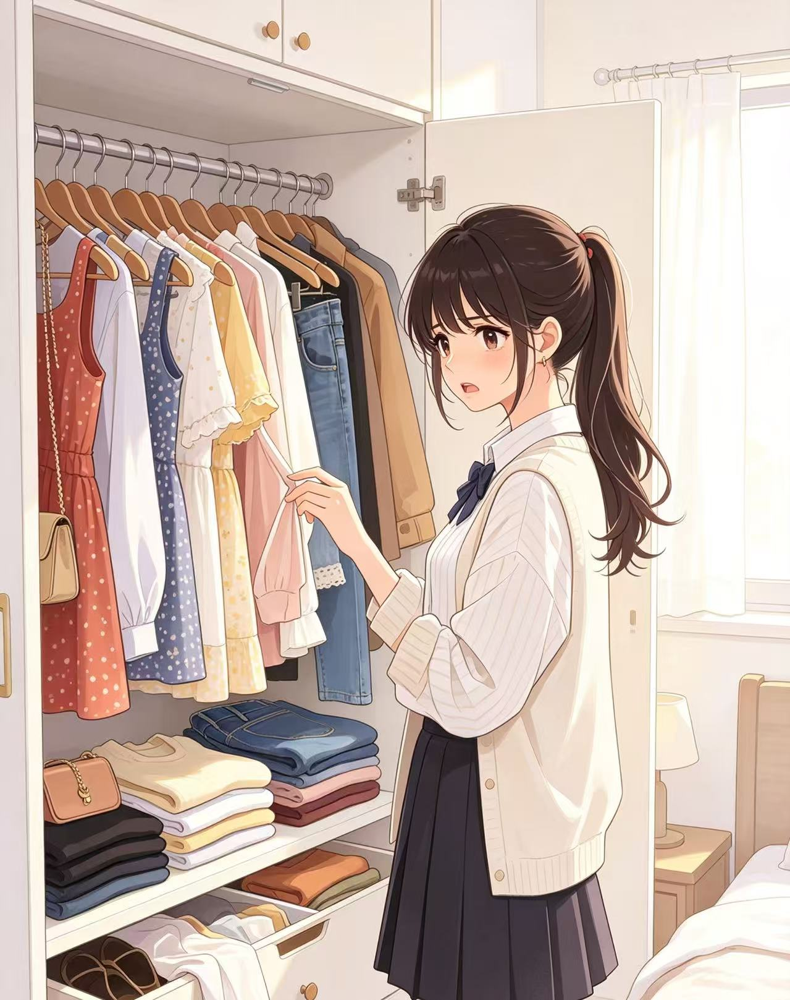
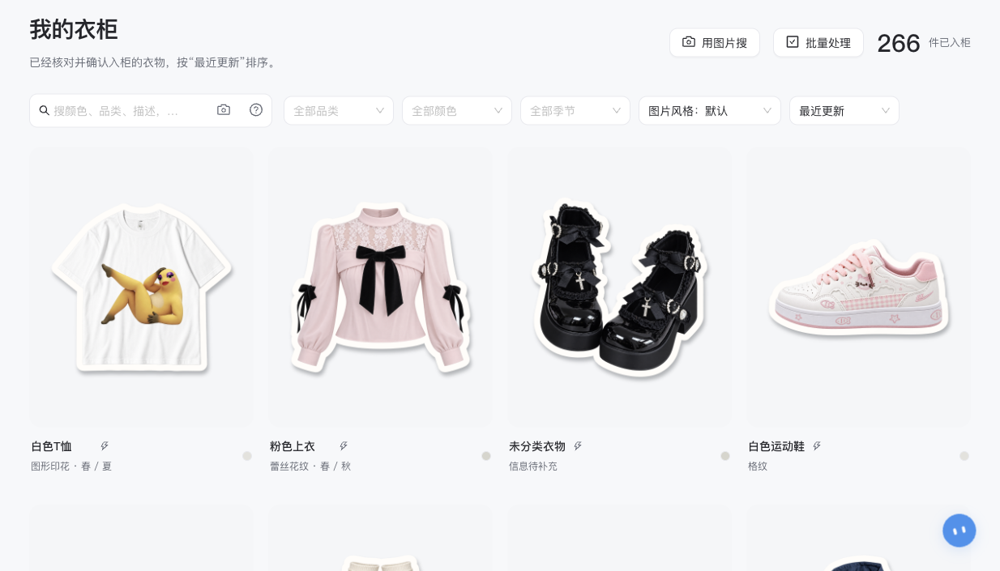
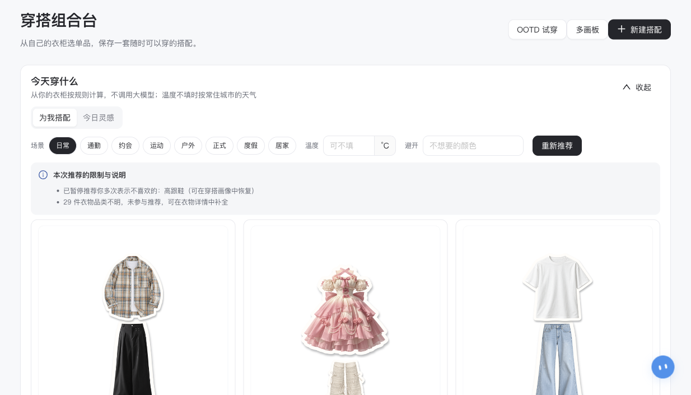

# website-enhancement_20261015_20261015_222739

- Source: `website-enhancement_20261015_20261015_222739.pptx`
- Total slides: 18

## Slide 1

AI 数字衣柜 · Web 网站

鱼搭

让已有衣物，
成为每天的选择。

参赛团队：鱼力无限 | 网页作品路演

鱼力无限 / 鱼搭 · AI 数字衣柜网站

01

### Speaker Notes

大家好，我们是鱼力无限团队，带来的网页作品叫鱼搭。它是一个 AI 数字衣柜和穿搭决策网站，从已有衣物出发，让每天的选择更容易理解和调整。

## Slide 2

目录

CONTENTS

项目背景与需求分析

产品与核心功能

1

2

照片分散 · 缺少决策依据

入柜 · 推荐 · 组合台 · OOTD

创新对比与算法

技术架构

3

4

可解释推荐 · 本地检索

Web · 本地模型 · 持久任务

市场与商业模式

团队与未来

5

6

用户验证 · 订阅与额度

鱼力无限 · 作品与规划

鱼力无限 / 鱼搭 · AI 数字衣柜网站

02

### Speaker Notes

这次路演先从用户的日常困境出发，再展示入柜、推荐、组合台与 OOTD 的产品闭环。之后解释创新机制、Web 技术架构和运行边界，最后讨论目标用户、盈利验证、团队能力与下一阶段计划。

## Slide 3

01 · 项目背景与需求分析

衣柜已经装满，
为什么仍不知道穿什么？

今天的场合和天气，
适合穿什么？

1

鱼搭给你建议

照片分散、灵感难落地，
出门前仍然反复选择那几件。

衣物多，难以记忆、
查找和整理。

2

鱼搭帮你记忆

收藏了穿搭灵感，
却难用自己的衣物还原。

3

鱼搭助你还原

鱼力无限 / 鱼搭 · AI 数字衣柜网站

03

### Speaker Notes

衣柜已经装满，为什么仍不知道穿什么？我们关注三个断点：场景和天气之间很难选择；衣物多而难以记忆、查找和整理；收藏了灵感，也难用自己的衣物还原。鱼搭分别提供建议、衣物记忆和组合辅助，先把这些问题接成日常可执行的流程。这里描述用户情景，不代表已经完成大规模需求调查。

## Slide 4

THE REFRAME

把衣柜变成决策资源。

从真实衣物出发，让每次选择都有依据。

拥有

理解

选择

反馈

真实衣物

属性与图像

场景、天气、风格

换件、喜好、恢复

库存成为起点

知道它适合什么

每次都有依据

影响下一次选择

让更多已有衣物进入日常；效果仍需用户验证。

鱼力无限 / 项目立意

04

### Speaker Notes

我们把衣柜看成一种决策资源：真实衣物是起点，属性和图像帮助理解，再按场景、天气、风格选择，最后把换件、喜好和恢复反馈带回下一次推荐。每次选择都应有依据，也允许用户接手。让更多已有衣物进入日常是产品目标，实际穿着效果还要用用户研究验证。

## Slide 5

02·产品与核心功能

拍照入柜，
在网站里管理自己的衣橱

批量上传 → 后台处理 → 核对入柜 → 进入真实衣柜

鱼力无限 / 鱼搭 · AI 数字衣柜网站

05

### Speaker Notes

用户在浏览器中拍照或批量上传，耗时操作进入后台处理，之后核对并确认入柜。衣物进入真实衣柜后，后续检索与搭配都围绕这些已有资产展开。画面展示的是可运行网站中的真实衣柜界面。

## Slide 6

02·产品与核心功能

一个从入柜到出门的闭环。

拍照入柜

混合检索

1

2

3

图片整理 · 属性修正

字段 · 文本 · 图像

计算推荐

组合 · 评分 · 理由

6

5

4

反馈调整

OOTD 预览

搭台编辑

有粒度 · 可恢复

模特 · 动作 · 调整

多画板 · 可接手

OOTD 为效果预览，不承诺真实尺码合身或衣物细节完全一致。

鱼力无限 / 鱼搭 · AI 数字衣柜网站

06

### Speaker Notes

完整用户链路包含六步：拍照入柜，混合检索，计算推荐，多画板搭台编辑，个人 OOTD 预览，以及反馈调整。检索结合字段、文本和图像，推荐提供组合、评分与理由，搭台允许用户编辑和接手，反馈有粒度也可以恢复。OOTD 支持模特、动作与调整，但只是生成式效果预览，不能证明真实尺码合身或保证衣物细节完全一致。

## Slide 7

浏览器里，把衣柜用起来

02 · 核心功能

我的衣柜：字段、语义与图像检索

组合台：推荐、编辑与保存搭配

批量上传 · 图片预处理

AI 自动抠图去背景

自动识别打标签

穿搭辅助

1

2

3

4

网站实际页面截图 · 2026-10-15 · 已裁去账户栏

鱼力无限 / 鱼搭 · AI 数字衣柜网站

07

### Speaker Notes

这两张是十月十五日访问本机网站得到的实际页面，截图裁去了账户栏。我的衣柜支持品类、颜色等字段筛选，以及语义和图像检索；组合台提供已有衣物的推荐、编辑和保存。产品把批量上传、图像预处理、本地抠图、自动识别和穿搭辅助连接起来，而不承诺一秒完成整个衣柜的整理。

## Slide 8

从用户问题，到可解释的实现

03 · 创新设计 / 机制与用户价值

维度

用户遇到的问题

鱼搭的实现机制

图片处理

上传与耗时处理混在一起

持久任务，提交后查看状态

图像可靠性

复杂背景、属性猜测难确认

本地抠图 + 属性证据与人工核对

推荐选择

不知道为什么，也总是重复

规则解释 + 曝光均衡 + 可恢复反馈

执行与成本

耗时任务与生成结果不确定

授权/回执/额度快照，未知不盲重试

鱼力无限 / 鱼搭 · AI 数字衣柜网站

08

### Speaker Notes

这一页从用户问题解释实现机制，不再对其他产品作未经验证的负面概括。持久任务把提交和耗时处理分开；本地抠图、属性证据和人工核对提高输入可靠性；规则理由、曝光均衡和可恢复反馈支持可解释选择。执行还受授权、回执和额度快照约束，上游结果未知时不会盲目重试。它们是当前项目可追溯的实现特点，不代表已经通过同一协议证明胜过所有竞品。

## Slide 9

照片入柜的三道可靠性工序

03 · 核心算法

图像规整

本地抠图

属性证据

1

2

3

尺寸与方向规整，
原图与展示派生分开。

U²-Net / GrabCut；
透明检查与恢复路径。

已确认 / 推测 / 未知 / 冲突
由用户核对后入柜。

耗时任务在后台运行；耗时随图片、模型与资源变化，不承诺固定秒数。

鱼力无限 / 鱼搭 · AI 数字衣柜网站

09

### Speaker Notes

照片入柜有三道可靠性工序。先规整尺寸和方向，原图与展示派生分开；本地 U²-Net 或 GrabCut 去背景，并提供透明检查和恢复路径；属性再区分已确认、推测、未知与冲突，由用户核对后入柜。耗时任务在后台执行，但实际耗时取决于图片、模型和资源，不能承诺固定秒数。U²-Net 是复用的预训练技术，不是自行训练的服饰专用分割网络。

## Slide 10

推荐有依据，变化也可计算

03 · 核心算法 / 计算推荐不依赖远程大模型决策

混合召回

规则与风格

曝光与反馈

1

2

3

字段与关键词先约束，
BGE / 可选 CLIP 补充相关性。

11 维当前评分、18 风格画像；
底线约束 + 可解释软评分。

动态候选、曝光均衡与重排；
时间衰减，让偏好可恢复。

复用预训练模型；项目贡献在领域特征、规则、重排和业务执行协议。

鱼力无限 / 鱼搭 · AI 数字衣柜网站

10

### Speaker Notes

推荐分成混合召回、规则与风格评分、曝光与反馈三个阶段。字段和关键词先约束候选，本地 BGE 和可选 CLIP 补充相关性；当前审美开启路径包含十一维评分和十八个风格画像，结构底线与可解释软评分一起工作。动态候选、曝光均衡与重排减少总推同几件，时间衰减让偏好可以恢复。计算推荐不依赖远程大模型决策，项目贡献在领域特征、规则、重排与执行协议；识图、对话和生图仍可能调用外部服务。

## Slide 11

网站架构：交互、计算与执行解耦

04 · 技术架构

Vue 3 / TypeScript / Ant Design Vue / Konva

明确的运行边界

浏览器响应式界面 · 衣柜、组合台与执行回执

任务有持久记录
网页内查看状态与通知
UNKNOWN 不自动重发
PWA 缓存应用外壳

Java 21 / Spring Boot / Spring Security

API、归属与权限 · 推荐规则 · 额度与持久任务

本地推理 + Agent + 统一任务执行器

ONNX：U²-Net / BGE / 可选 CLIP；LangGraph 对话编排；
CPU / 识别 / 生成分池，公平调度与保守恢复。

H2 / Flyway / MyBatis Plus · 本地或 S3 图片

默认可控单机部署；Docker / CI；管理 API 可插拔且默认关闭

鱼力无限 / 鱼搭 · AI 数字衣柜网站

11

### Speaker Notes

鱼搭是响应式 Web 网站，前端采用 Vue、TypeScript、Ant Design Vue 和 Konva，承载衣柜、组合台与执行回执。Java 二十一、Spring Boot 和 Security 掌握 API、数据归属、规则、额度与任务；ONNX 运行本地抠图、文本和可选图文模型，LangGraph 编排对话，统一执行器按资源池调度。H2、Flyway、MyBatis Plus 和本地或 S3 图片组成持久层，Docker 与持续集成支撑交付，管理接口默认关闭。网页内查看任务和通知，PWA 缓存应用外壳；当前是可控单机架构，不承诺未经压测的水平扩展或浏览器后台推送。

## Slide 12

先验证谁会反复使用

05 · 目标用户与进入市场

衣物不少、选择很难的高校与初入职场人群。
先从高频通勤与日常搭配任务验证价值。

待验证的市场假设

第一次就能用上

1

入柜并完成一套可采纳搭配

每天愿意再回来

切入点：校园与穿搭社群共创

2

观察真实使用，不拿曝光当穿着

计划招募 30–50 位共创者，观察四周；
记录采纳、实际穿着覆盖、留存和付费意愿。

持续价值能收费

3

访谈与小额实验验证付费意愿

鱼力无限 / 鱼搭 · AI 数字衣柜网站

12

### Speaker Notes

市场进入先围绕衣物不少、选择很难的高校和初入职场人群，从高频通勤与日常搭配验证价值。我们计划通过校园和穿搭社群招募三十到五十名共创者，观察四周，记录采纳、实际穿着覆盖、留存与付费意愿。第一次能否得到可采纳的搭配、每天是否愿意回来、持续价值能否收费，是三个待验证问题。这里的人数和周期是计划，不是已有用户规模。

## Slide 13

从日常服务，走向可验证的收入

05 · 商业设计 / 待验证，未形成付费成绩

1

2

3

持续订阅

OOTD 生成额度

未来机构工作台

基础衣柜与计算推荐作为入口；
高级管理、长期洞察与
专属服务探索订阅。

按次或额度包收费，
覆盖真实上游生成成本；
不承诺无限生成。

与造型、衣柜整理服务商
共创授权工作台；
不出售用户衣柜数据。

情景演算：10,000 活跃用户 × 5% 转化 × 199 元/人/年 = 9.95 万元/年

仅演算年订阅收入；未扣获客、计算、存储、支持与税费，不是预测或净利润。

鱼力无限 / 鱼搭 · AI 数字衣柜网站

13

### Speaker Notes

商业设计分三条待验证路径：基础衣柜和计算推荐作为入口，高级管理、长期洞察与专属服务探索订阅；OOTD 按次或额度包收费，覆盖真实上游成本，不承诺无限生成；未来与造型、衣柜整理服务商共创授权工作台。我们不出售用户衣柜数据。下面只是情景演算：一万活跃用户、百分之五转化、每人每年一百九十九元，得到九点九五万元年订阅收入；未扣获客、计算、存储、支持和税费，不是预测、净利润或现有收费成绩。

## Slide 14

现在做到哪一步了

06 · 项目进展

Web 网站闭环

搭台与个人 OOTD

工程与管理接入

真实用户与付费

衣柜、入柜、搜索与推荐
已在源码中打通。

多画板、模特/动作与
生成确认已有实现。

持久任务、归属控制；
管理 API 默认关闭。

共创、留存与单位成本，
仍需下一阶段验证。

已完成

已完成

已有实现

下一步验证

鱼力无限 / 鱼搭 · AI 数字衣柜网站

14

### Speaker Notes

当前源码已经打通 Web 衣柜、入柜、搜索和推荐，搭台与个人 OOTD 也已有多画板、模特动作和生成确认等实现。工程上有持久任务和数据归属控制，可插拔管理接口默认关闭。这里的已有实现来自项目代码与既有验证材料，不代表本轮重跑全部业务测试。真实用户留存、付费与单位成本仍是下一阶段的验证任务。

## Slide 15

把“总穿那几件”变成可测问题

06 · 历史实验 / 固定意图，连续模拟 28 天

167 件

49 → 97 件

20% → 8%

仍需真实验证

仿内测衣柜

进入推荐的衣物

单品最高占比

曝光不等于实际穿着

实验条件

曝光覆盖改善

降低过度集中

下一步：用户研究

支持推荐曝光覆盖改善，不等同真实穿着率或消费减少。

来源：2026-10-10 审美报告；历史模拟，非本轮重测；并非所有公平指标都改善。

鱼力无限 / 鱼搭 · AI 数字衣柜网站

历史模拟，非实际穿着

15

### Speaker Notes

历史审美报告记录了一组固定意图、连续二十八天的模拟，使用一百六十七件仿内测衣柜。进入推荐的衣物从四十九件增加到九十七件，单品最高占比从百分之二十降到百分之八，支持曝光覆盖改善和过度集中减少。来源是十月十日的报告，非本轮重测，也并非所有公平指标都改善。推荐曝光不是实际穿着率，更不能直接推导消费减少，下一步仍需真实用户研究。

## Slide 16

参赛团队：鱼力无限

06 · 四项能力方向 / 不代表成员人数

1

2

3

4

前端开发

后端架构

算法与图像处理

产品与设计

网站界面、响应式交互与画布

API、任务执行、权限与存储

规则推荐、本地检索与图像处理

需求、交互与视觉、文档

团队起点与作品证据

全新团队，第一次参加比赛。

暂无过往竞赛奖项；用产品闭环、算法依据和工程交付接受评审。

鱼力无限 / 鱼搭 · AI 数字衣柜网站

16

### Speaker Notes

我们的参赛团队名是鱼力无限，这是团队第一次参加比赛，暂无过往竞赛奖项。页面上的前端、后端、算法图像、产品设计是四项能力方向，不代表已经确认的四位成员或其履历。我们以网站产品闭环、领域算法依据和工程交付作为本次作品证据，接受评委检验。

## Slide 17

下一步怎么走

06 · 未来规划

1

2

3

短期 · 打磨体验

中期 · 做深价值

长期 · 拓展 B 端

修正入柜摩擦与图片质量
记录采纳和实际穿着覆盖
完善未知任务对账与压测

在已有推荐上验证留存
试验订阅与生成额度
核算真实单位服务成本

与造型/整理服务商共创
验证授权工作台的需求
评估数据库与容量扩展

鱼力无限 / 鱼搭 · AI 数字衣柜网站

17

### Speaker Notes

短期继续修正入柜摩擦和图片质量，记录采纳与实际穿着覆盖，完善未知任务对账并开展压力测试。中期在已经实现的推荐上验证留存，试验订阅和生成额度，核算真实单位服务成本。长期与造型或整理服务商共创授权工作台，再评估数据库和容量扩展。路线图是待执行计划，不把已有推荐写成未来才上线，也不把未知收费请求当成普通失败自动重发。

## Slide 18

鱼力无限 · 鱼搭 AI 数字衣柜网站

理解衣柜，解释选择。
让已有衣物，重新有机会。

欢迎现场体验网站 · 共创验证日常穿搭价值

鱼力无限 / 鱼搭 · AI 数字衣柜网站

18

### Speaker Notes

鱼力无限团队希望通过鱼搭这个网站，帮助用户理解衣柜、解释选择，让已有衣物重新获得机会。欢迎现场体验，并参与下一阶段的共创验证，让这个产品的价值由真实日常使用来回答。
