

# 鱼搭：可解释的 AI 数字衣柜与穿搭决策系统

### 作品介绍文档

| 项目 | 内容 |
|---|---|
| 作品名称 | 鱼搭：可解释的 AI 数字衣柜与穿搭决策系统 |
| 作品形态 | Web 网站（支持 PWA 安装，桌面与手机浏览器均可使用） |
| 参赛团队 | 鱼力无限 |
| 所属学校 / 学院 | 【待填写】 |
| 指导老师 | 【待填写】 |
| 团队成员 | 【待填写】 |
| 文档版本 | 2026 年 10 月 18 日，对应后端 `5d2faa3`、用户端 `06b35b1` |

## 目录

- [第一章 项目简介](#第一章-项目简介)
- [第二章 需求分析](#第二章-需求分析)
- [第三章 系统设计](#第三章-系统设计)
- [第四章 核心算法](#第四章-核心算法)
- [第五章 功能实现与界面展示](#第五章-功能实现与界面展示)
- [第六章 测试报告](#第六章-测试报告)
- [第七章 创新点](#第七章-创新点)
- [第八章 应用价值](#第八章-应用价值)
- [第九章 总结与展望](#第九章-总结与展望)
- [附录 术语与资料来源](#附录-术语与资料来源)

## 第一章 项目简介

### 1.1 衣柜满了，为什么还是不知道穿什么？

出门前，人们面对的往往不是“有没有衣服”，而是一连串选择：今天的场合和温度适合什么？这件上衣配哪条裤子？那条很久没穿的裙子还能怎么搭？收藏了很多穿搭照片，却很难用自己已有的衣物还原出来。结果常常是反复穿同几件，其余衣物被遗忘在衣柜深处。

**鱼搭**从这段每天都会发生的决策出发，为用户建立一个“看得见、搜得到、会搭配、能解释”的数字衣柜：

- 拍一张照片，系统在本地抠图、整理属性，衣物就进入个人衣柜；
- 说一句“明天通勤，想要千金风，换双鞋”，系统从**用户自己的衣物**里算出几套搭配，并逐项说明为什么这样搭、为什么没选那件；
- 满意的方案放到画板上继续编辑，也可以在确认参数和额度后，生成穿在自己基准人物身上的 OOTD 效果图；
- 每一次“换一件”“不喜欢”“今天穿了这套”都会让之后的推荐更贴近用户，而这些偏好用户随时可以查看、恢复或清空。

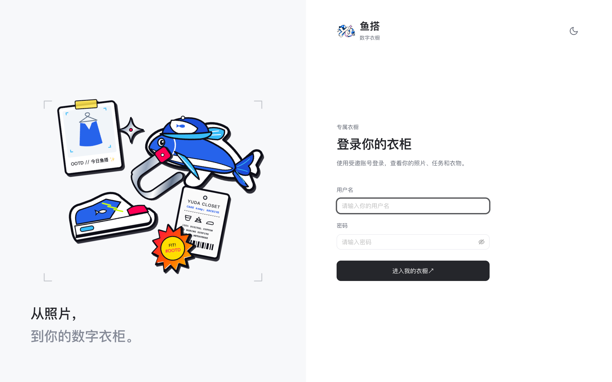

图 1-1 鱼搭登录页（本地运行网站实拍，2026-10-18）

### 1.2 一段话介绍

鱼搭是面向已有衣物的可解释 AI 数字衣柜与穿搭决策系统。项目打通了照片入柜、混合检索、算法推荐、多画板编辑、个人 OOTD 预览与反馈调整的完整闭环。推荐引擎把穿着结构底线、11 维审美评分、18 个中文风格画像和曝光均衡结合起来，给出具体到单品和规则的依据；大模型只负责理解自然语言、识别图片和生成效果图。借助本地模型推理、生成前的明确确认和可恢复的持久任务，鱼搭探索一种可解释、可控制、可持续使用的个人穿搭工具。

### 1.3 核心设计理念：能用代码算的，不交给模型猜

| 交给代码 | 交给大模型 |
|---|---|
| 候选召回、组合、打分、换一批、换一件、今日灵感、搜索、取色——**全部零模型调用** | 理解“甜一点”“明天降温”这类自然语言，填入结构化意图 |
| 每一项得分、每一条规则命中都可追溯、可复现 | 识别衣物照片中的品类、材质等属性（结果标为“推测”，待用户确认） |
| 本地 ONNX 推理完成抠图与语义向量 | 生成个人 OOTD 效果图（用户确认参数与额度后才提交） |

这种分工带来三个好处：**推荐有依据**（不是黑盒）、**外部调用可控**（不必每次把整个衣柜发给远程模型）、**权限与执行结果掌握在业务后端**（模型说“完成了”不算数，浏览器回执才算）。

### 1.4 业务闭环

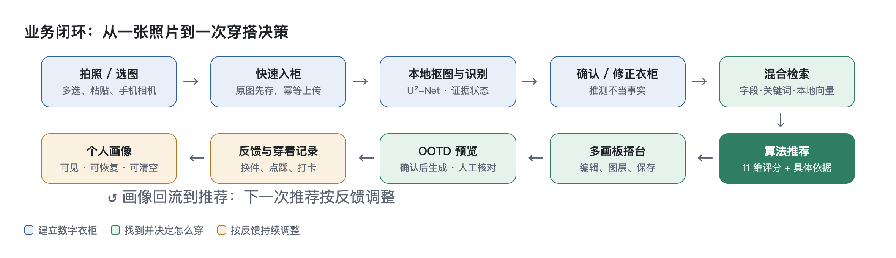

图 1-2 鱼搭业务闭环：建立衣柜 → 找到并决定怎么穿 → 按反馈持续调整

### 1.5 项目规模

| 指标 | 数值 |
|---|---|
| 后端 Java 源文件 | 221 个，约 2.2 万行（24 个业务包） |
| 用户端源文件（TS / Vue / CSS） | 176 个，约 1.6 万行；Vue 组件 96 个 |
| Agent 运行时 | TypeScript + LangGraph，独立进程 |
| 数据库 | 65 张表，Flyway 迁移 V1–V27 |
| 自动化测试 | 后端 114 个测试类、572 项；前端 25 个测试文件、105 项 |
| 设计与验收文档 | 75 篇（总设计、专项实现设计、验收报告） |

## 第二章 需求分析

### 2.1 用户痛点与设计回应

| 痛点 | 鱼搭的回应 | 可验证的指标 |
|---|---|---|
| 衣物照片分散、属性说不清 | 快速入柜、本地抠图、属性证据状态（已确认 / 推测 / 未知 / 冲突）与人工修正 | 录入耗时、基础图成功率、属性修正率 |
| 只给一套结果，不知道为什么 | 规则命中记录、分维度评分、入选与未入选解释 | 理由与衣物一致率、用户理解度 |
| “甜一点”“多巴胺”太模糊 | 18 个中文风格画像，按颜色、面料、图案、细节线索计算 | 风格检索命中、反例误判 |
| 总推荐同几件，其余衣物闲置 | 动态召回、曝光债、跨天轮换、主体多样化 | 衣物曝光覆盖、单品最高占比 |
| AI 任务等待、断网、失败后状态不清 | 持久任务、资源许可、冻结输入、UNKNOWN 不盲目重发 | 重启后状态一致、重复派发次数 |
| 反馈被忽略或被永久固化 | 多层反馈、时间衰减、可恢复冷却、可清空画像 | 反馈即时生效、恢复后的行为变化 |

### 2.2 目标用户

- **衣物较多、搭配犹豫的年轻用户**：想更好地利用已有衣物，而不是继续买。
- **通勤 / 学生群体**：需要在固定场景下快速得到“今天穿什么”，并避免总穿同一套。
- **喜欢风格化穿搭的用户**：用“千金”“多巴胺”“新中式”等词表达审美，希望系统真正听懂。

### 2.3 同类产品对比

以下仅采用官方公开页面信息（核查日期 2026-10-13），未购买付费账号逐项体验，也不推断未公开的内部机制。

| 产品 | 官方公开的相关能力 | 与鱼搭的关系 |
|---|---|---|
| Acloset | 照片识别整理、按天气与场合推荐、聊天表达偏好、虚拟试穿、穿着记录、购物导入 | 入柜、AI 助手、试穿是重叠能力 |
| Whering | 去背景、衣柜检索、日常搭配、好友衣柜、穿搭计划、旅行打包、单次穿着成本 | 社交与规划是其成熟优势 |
| Stylebook | 自由画布拼贴、Outfit Shuffle、AI 去背景、穿着日历、打包清单、统计 | 画布与批量导入不是独创 |

功能重叠说明选题有真实需求。鱼搭的差异不在“有没有推荐”，而在于**推荐怎样算出来、怎样解释、怎样让用户控制**：可复现的规则评分、中文风格线索、曝光均衡、带回执的助手执行、生成前的确认与冻结输入。具体见第七章。

### 2.4 用例分析

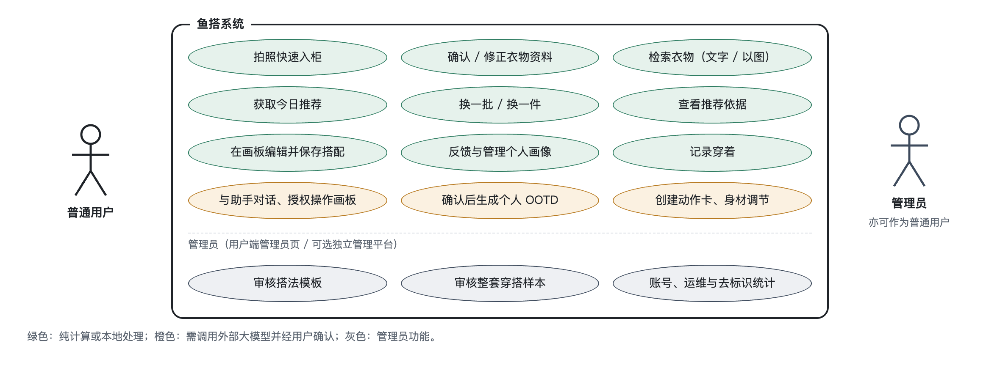

图 2-1 系统用例图

### 2.5 非功能需求

| 类别 | 要求与实现 |
|---|---|
| 隐私 | 推荐不向模型发送衣物完整资料、性别或身材数据；私有图片经身份与归属校验；敏感记忆按用途授权 |
| 安全 | Cookie/JDBC 会话、CSRF、账号归属校验；首次登录必须改初始密码；便携登录票据单次兑换、只存哈希 |
| 可靠性 | 耗时操作进入持久任务；重启后未派发任务恢复排队，已派发结果未知的任务不自动重发 |
| 成本可控 | 生成类操作“准备 → 用户确认 → 提交”，展示参考图片与额度；共享账户按并发与 RPM 限流 |
| 可回退 | 审美组、曝光均衡、风格画像等 `closet.recommend.*` 开关均可关闭，回到上一阶段行为 |
| 可部署 | Docker / Compose；图片可在本地与 S3 兼容桶之间一键迁移；管理接口默认关闭 |
| 易用 | 统一 Ant Design Vue 组件；桌面侧栏可折叠；手机端底部面板、左右滑动切换衣物；PWA 安装 |

## 第三章 系统设计

### 3.1 总体架构

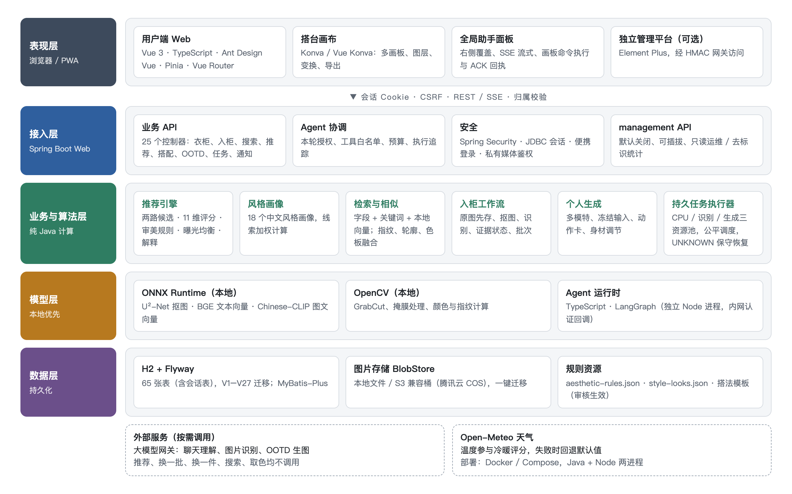

图 3-1 系统总体架构

系统由五层组成。常规部署只有两个进程：**Java 业务服务**（Spring Boot，含推荐引擎、任务执行器、本地模型推理）与 **Node Agent 运行时**（LangGraph）。两者通过带内部凭证的 HTTP 回调协作，浏览器只和 Java 服务通信。

### 3.2 技术选型

| 层次 | 技术 | 选择理由 |
|---|---|---|
| 用户端 | Vue 3、TypeScript、Vite、Pinia、Vue Router | 组件化、多状态业务界面；类型约束衣物、任务、画板、推荐协议 |
| UI 组件 | Ant Design Vue | 统一交互控件，禁止混用原生控件，保证一致体验 |
| 画布 | Konva / Vue Konva | 多画板、图层、拖动变换、导出 |
| 后端 | Java 21、Spring Boot、Spring Security、Spring Session | 虚拟线程处理大量 I/O；成熟的安全与会话方案 |
| 持久化 | H2、Flyway、MyBatis-Plus | 单机易部署；版本化迁移；轻量 ORM |
| 本地推理 | ONNX Runtime、OpenCV | U²-Net 抠图、BGE 文本向量、Chinese-CLIP 图文向量在本机运行 |
| Agent | TypeScript、LangGraph | 工具调用编排；与业务后端解耦，模型可替换 |
| 存储 | 本地文件 / S3 兼容（腾讯云 COS） | 通过 `BlobStore` 切换，附一键迁移与校验脚本 |
| 部署 | Docker、Docker Compose、GitHub Actions | 容器构建与部署流水线 |

### 3.3 功能模块

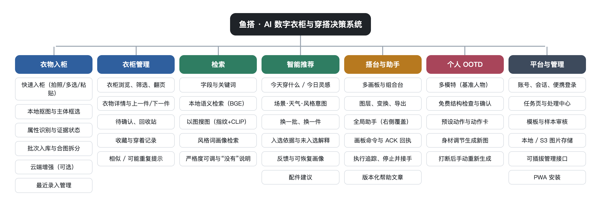

图 3-2 功能模块图

### 3.4 关键流程设计

#### 3.4.1 快速入柜

入柜的关键是**资产与任务分开**：原图先保存，再建立工作流。即使后续识别或增强失败，用户已经拥有可用的衣物图片。上传使用稳定的上传编号与内容指纹，相同编号、相同内容返回同一结果，避免网络重试导致重复入柜。

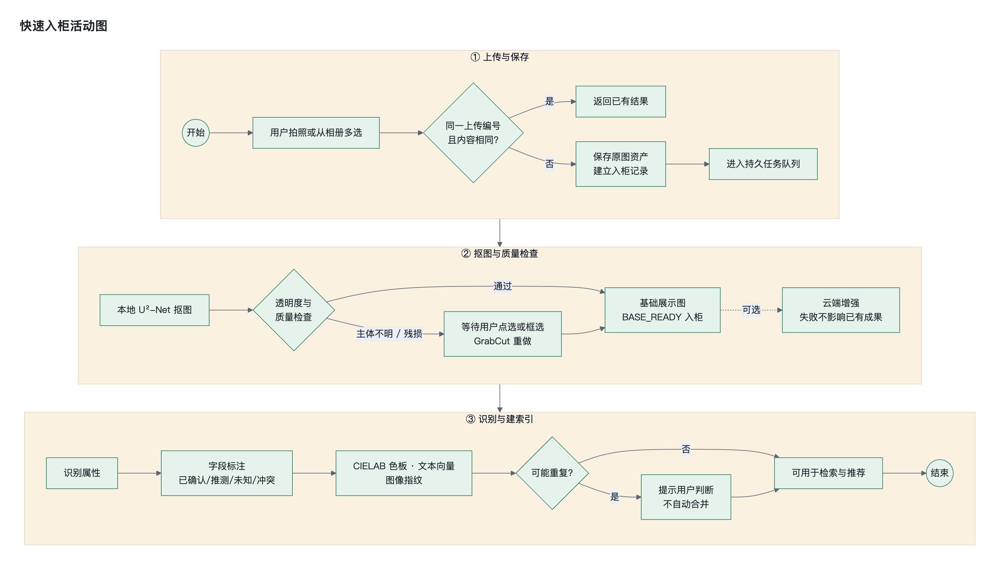

图 3-3 快速入柜活动图

#### 3.4.2 助手操作画板

全局助手覆盖在主界面右侧，不挤压页面，可固定、拖动、关闭。助手修改画板时，后端只发出命令，**真正的修改在浏览器完成并回执**；后端核对 operationId、顺序号与对象版本后才记录为完成。迟到或已取消的回执会被拒绝，用户可以随时“停止并接手”。

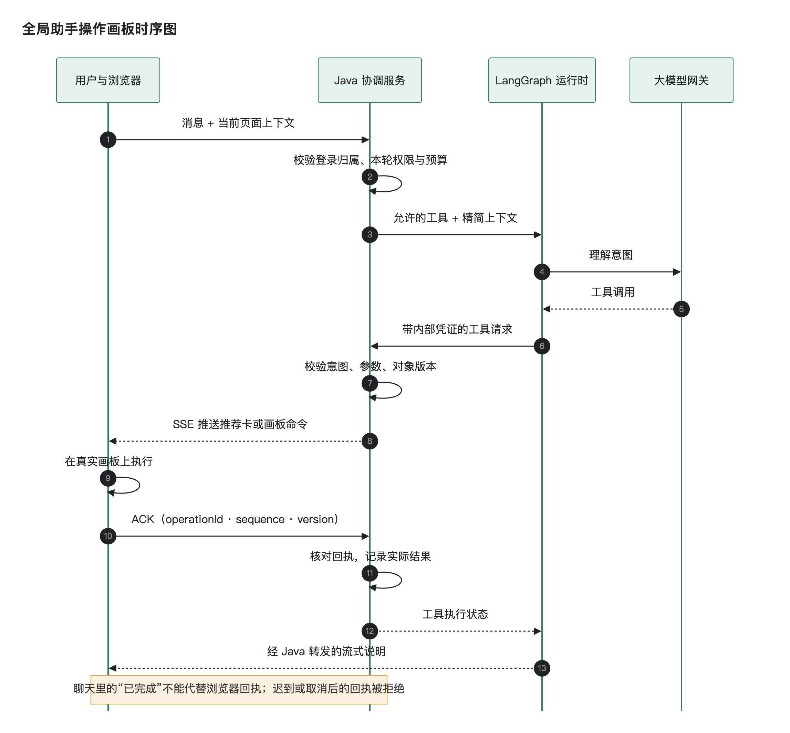

图 3-4 助手操作画板时序图

#### 3.4.3 个人 OOTD 生成与任务状态

生成是付费且耗时的操作，因此分为“准备”与“提交”两步：先免费检查穿着结构，再冻结参考图、衣物与模特版本、提示词版本和动作，用户核对清单与额度后确认。服务在调用中途重启时，任务进入“结果未知”，**不自动重发**，避免重复扣费；页面写明原因，用户确认后可按原冻结输入一键重新生成。

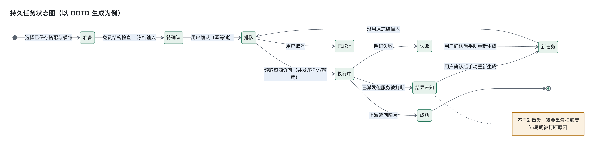

图 3-5 持久任务状态图（以 OOTD 生成为例）

所有耗时任务共用一个执行器：CPU、识别、生成三个资源池分别限并发；任务按账户公平轮换领取；资源许可再约束共享上游账户的并发与每分钟请求数，并为助手预留容量。

### 3.5 数据库设计

数据库共 65 张表（含 2 张 Spring Session 会话表），由 Flyway 从 V1 迁移到 V27。按业务划分为五个数据域：

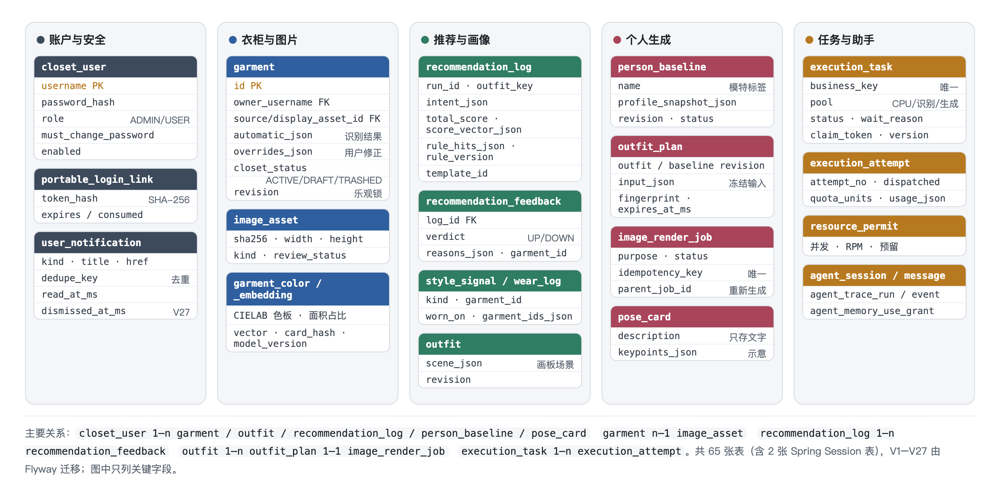

图 3-6 核心数据实体与关键字段

以下列出四张核心表的结构。

**表 3-1 衣物表 `garment`**

| 字段 | 类型 | 说明 |
|---|---|---|
| id | VARCHAR(36) | 主键 |
| owner_username | VARCHAR(80) | 所属用户，所有查询按归属过滤 |
| source_asset_id / display_asset_id | VARCHAR(36) | 原图与展示图，引用 `image_asset` |
| automatic_json | TEXT | 识别得到的属性，带证据状态 |
| overrides_json | TEXT | 用户修正，与自动结果分开存，重新识别不覆盖 |
| closet_status | VARCHAR(16) | ACTIVE / DRAFT / TRASHED |
| name、favorite | — | 名称、收藏 |
| revision | BIGINT | 乐观锁版本，防并发覆盖；向量、色板按它失效重算 |
| created_at_ms / updated_at_ms | BIGINT | 时间戳 |

**表 3-2 推荐记录表 `recommendation_log`**

| 字段 | 类型 | 说明 |
|---|---|---|
| id / run_id | VARCHAR(36) | 记录主键 / 同一次推荐的批次号 |
| intent_json | CLOB | 当时的结构化意图 |
| outfit_key、garment_ids_json | — | 这套搭配及其衣物 |
| rank_no、total_score | — | 排名与总分 |
| score_vector_json | CLOB | 11 个维度的分项得分 |
| rule_hits_json、rule_version | — | 命中的规则与规则版本，支撑“为什么” |
| template_id | VARCHAR(80) | 若来自已审核搭法，记录搭法编号 |

**表 3-3 执行任务表 `execution_task`**

| 字段 | 类型 | 说明 |
|---|---|---|
| business_key | VARCHAR(180) | 业务唯一键，防重复建任务 |
| kind / stage / pool | — | 任务类型、阶段、资源池（CPU / 识别 / 生成） |
| account_id、priority | — | 共享上游账户、优先级 |
| status、wait_reason | — | 状态与白话等待原因 |
| claim_token、version | — | 条件更新领取，防止两个线程同时执行 |
| next_run_at_ms | BIGINT | 退避后的下次执行时间 |
| input_version、result_json | — | 输入版本与结果 |

**表 3-4 生成任务表 `image_render_job`**

| 字段 | 类型 | 说明 |
|---|---|---|
| purpose | VARCHAR(20) | 基准人物 / OOTD / 身材调节 |
| baseline_id、plan_id | VARCHAR(36) | 模特与冻结计划（`outfit_plan`） |
| input_json | TEXT | 冻结的生成输入 |
| status、error_message | — | 状态与原因（含“被重启打断”说明） |
| idempotency_key | VARCHAR(100) | 与用户组成唯一约束，重复提交返回同一任务 |
| parent_job_id | VARCHAR(36) | 由哪个任务重新生成而来 |
| deletion_epoch | BIGINT | 删除代次，防止已删除文件被恢复 |

### 3.6 安全与隐私设计

- **账号与会话**：Spring Security + JDBC 会话；初始密码必须修改；登出、CSRF 失败与未登录有不同响应，不扩大业务权限。
- **便携登录**：在可信设备之间临时登录。链接 10 分钟有效、单次兑换，数据库只存 SHA-256；票据放在 URL 片段中，不进入服务端日志。
- **私有媒体**：人物照、生成图等私有文件每次访问都经过身份与归属检查。
- **模型数据最小化**：推荐不向模型发送完整衣物资料、性别或身材；动作参考图不保存、不发给生图模型，只保留文字描述与示意关节；整套穿搭样本审核完成即删除原图，疑似未成年自动拒收。
- **可插拔管理接口**：默认关闭，HMAC 签名 + 时间窗口 + nonce 防重放；核心代码不得依赖管理包（由架构测试守护）；大屏与数仓出口只用去标识的 userKey，不返回用户名、衣物名称、图片或聊天内容。

## 第四章 核心算法

### 4.1 推荐引擎总流程

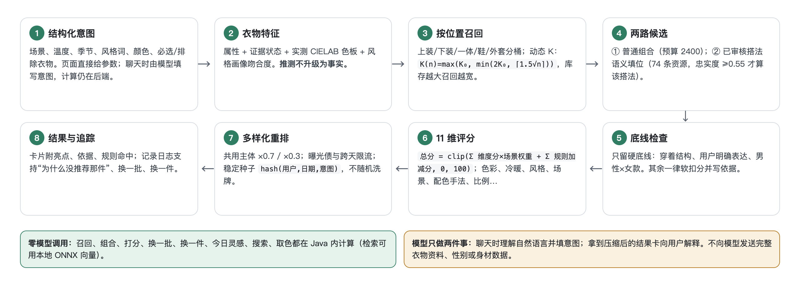

图 4-1 推荐引擎流水线

**按位置召回**：衣物按上装、下装、一体服、鞋、外套等位置分桶，结合字段、关键词、风格线索与本地语义相关度召回。基础召回数为上装 15、下装 10、一体 8、鞋 6、外套 5；衣柜越大，召回越宽：

$$K(n) = \max\big(K_{base},\ \min(2K_{base},\ \lceil 1.5\sqrt{n}\ \rceil)\big)$$

**两路候选**：普通路径在 2400 组合预算内组合；另一条路径用管理员审核过的“搭法”（当前资源 74 条）去衣柜中语义填位。只有每个位置都被忠实填入，才算作该搭法并加分，否则当作普通组合，避免“名不副实”。

**底线只留三条**：穿着结构完整、用户明确表达的要求、男性 × 女款。厚薄、季节、风格、正式程度都改为软扣分，并写明依据——宁可让用户看到“这套偏薄（−3）”，也不悄悄删掉。

### 4.2 11 维评分

$$\text{总分} = \text{clip}\Big(\sum_i \text{维度分}_i \times \text{场景权重}_i + \sum_j \text{规则加减分}_j,\ 0,\ 100\Big)$$

每个维度分在 0–1 之间，不同场景的权重不同（每列合计 100）：

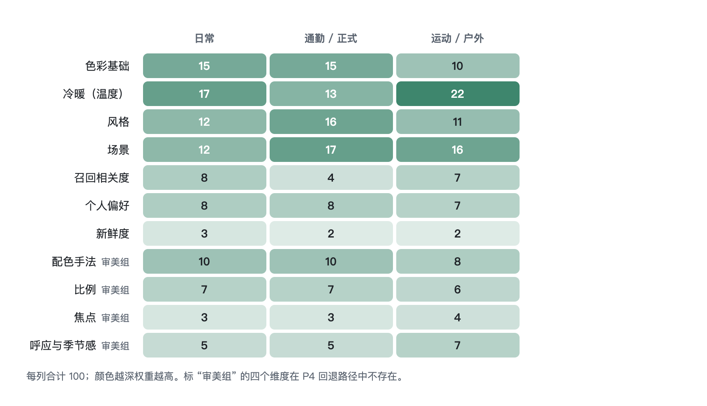

图 4-2 11 个评分维度在不同场景下的权重

审美组根据全身色板、各位置面积、版型、长度、视觉重量计算配色手法、比例、焦点与呼应。规则资源包含 **105 格颜色对**和 **78 格材质对**的完备避坑表，每一格都有结论和理由（由 `AestheticRulesTest` 守护）。审美组只加分，不制造提醒。分数表示系统规则下的相对匹配程度，而不是客观的“颜值分”。

### 4.3 多样化与曝光均衡

推荐长期集中在少数衣物，是数字衣柜最常见的问题。鱼搭在贪心选择时对重复主体降权（共用一件主体 ×0.7，共用两件或完全重复 ×0.3），并引入**曝光债**：近期很少被展示的衣物获得召回名额与有限加分；近期曝光过高、且存在质量相近替代品的衣物会被限流。

为了让“同一天、同一意图”看到稳定结果，并列时不随机洗牌，而是用稳定种子：

$$\text{选择分} \approx \big(\text{总分} + 1.5 \times \text{hash}(\text{用户}, \text{日期}, \text{意图}, \text{outfitKey})\big) \times \text{主体重复系数} \times \text{结构系数} \times \text{曝光限流系数}$$

“新尝试”有单独的质量门槛，不会为了提高覆盖而推荐明显不好的搭配（`balanceNeverPromotesABadOutfit`）。

### 4.4 中文风格画像

`style-looks.json` 定义了 18 个风格画像，如甜美、多巴胺、千金、小香风、老钱、森系、新中式、洛丽塔。每个画像由颜色族、CIELAB 色调、图案、面料、品类、版型和关键词线索组成。每组取最强正线索与最强负线索，加权求和后除以 1.6 并截断到 [−1, 1]，避免同义线索重复累加；整套再按各位置视觉面积加权。

$$\text{愿望分} = \text{clip}\big(16 \times (\text{吻合度} - 0.25),\ -8,\ 8\big)$$

例如“多巴胺”要求亮色占足够面积——一条黑白蝴蝶结裙即使带“甜美”标签，也不会被当作多巴胺；“千金”看重低彩度、珍珠、粗花呢、合体剪裁，与卡通或女仆元素区分开。画像数据由离线模型起草、人工修订，运行时纯计算。

### 4.5 本地语义检索：区分“相似”和“没有”

衣物字段组合成描述卡，经 BERT WordPiece 分词后由本地 BGE ONNX 模型编码为 512 维向量（L2 归一化），余弦相似度即点积。个人衣柜规模下直接比较，不需要向量数据库。

最难的问题是“衣柜里根本没有”时不要硬凑结果。默认相关性门槛要求同时满足：

$$s \ge 0.35,\qquad s - \text{median}(s) \ge 0.06,\qquad s \ge s_{best} - 0.12$$

即绝对够像、相对突出、接近最佳三条同时成立。颜色和品类是硬条件：搜“白色上衣”不会把字段明确为粉色的衣物返回。模型不可用时自动降级为关键词检索，并在界面说明。

### 4.6 颜色测量与抠图

- **取色**：跳过透明度 < 128 的像素，采样到最长边 96，RGB 转 CIELAB，确定性初始化的 k-means（k=3，最多 12 轮），输出色中心与面积占比。CIELAB 能计算明度、彩度、色相与色差，比“红 / 蓝”标签更适合判断配色层次。
- **抠图**：U²-Net 本地显著性分割；主体不明时用 GrabCut 按用户框选重做；`CutoutCheck` 检查伪透明与主体残损。

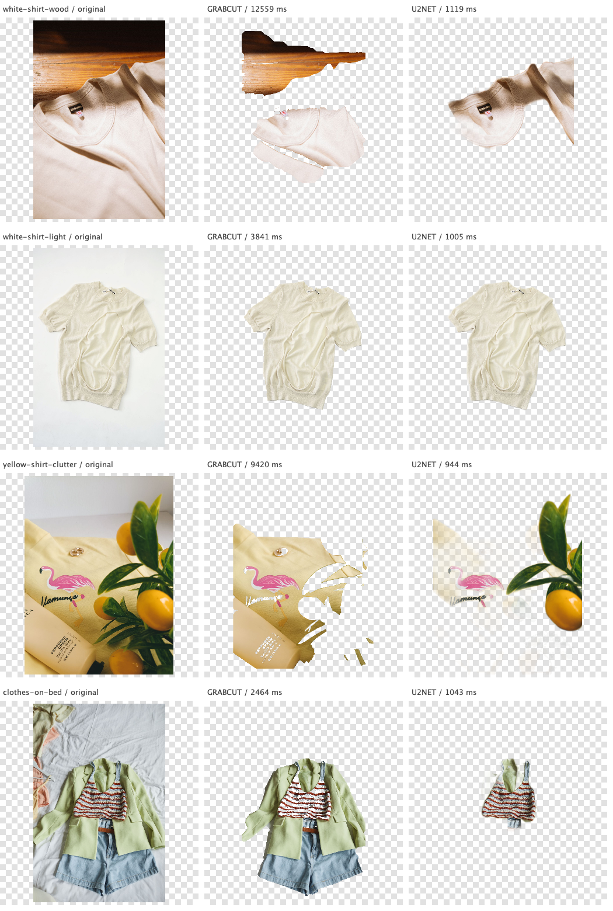

图 4-3 抠图方法对比（左起：原图、GrabCut、U²-Net；项目早期本地实验）

### 4.7 相似衣物与以图搜图

视觉指纹包括 32×32 灰度 DCT 的 64 位感知哈希、8×8 主体轮廓格、宽高比与 CIELAB 色板，并可结合 Chinese-CLIP 图像向量。多路分数按可用项重新归一化融合：

$$\text{相似度} = \frac{\sum_{k \in \text{可用}} w_k \cdot s_k}{\sum_{k \in \text{可用}} w_k},\quad w = \{\text{图像}0.54,\ \text{文本}0.30,\ \text{颜色}0.25,\ \text{轮廓}0.20,\ \text{外观}0.15,\ \text{字段}0.10\}$$

结果只提示“可能重复”，由用户判断，不自动合并；用户标记“不是重复”后不再提醒。

### 4.8 反馈与个人画像

反馈作用在六个层次：整套、单品对、类别对、指定单品、画风混搭和部分规则。“换掉一件”只表示它在这套里不合适，不等于讨厌这件衣服。信号随时间衰减：

$$w(t) = w_0 \times 0.5^{\,t / T_{1/2}},\qquad T_{1/2}^{负面} = 30\ \text{天},\quad T_{1/2}^{正面} = 60\ \text{天}$$

连续不喜欢会进入冷却，但之后的喜欢或时间衰减都能让它恢复。所有个人偏移都有上限，并在设置页可见、可清空。

## 第五章 功能实现与界面展示

> 本章截图均来自本地运行的鱼搭网站，采集于 2026-10-07 至 10-18 的各轮验收；生成类图片为隔离测试中的合成示例。

### 5.1 快速入柜

“拍一件，收一件”：手机直接拍照，或从相册多选、拖入、Ctrl/⌘+V 粘贴。贴纸做好后自动入柜，无需逐件确认，资料随时可以修改。“最近录入”显示每张照片的录入时间，可以删除单条或清空本机记录。

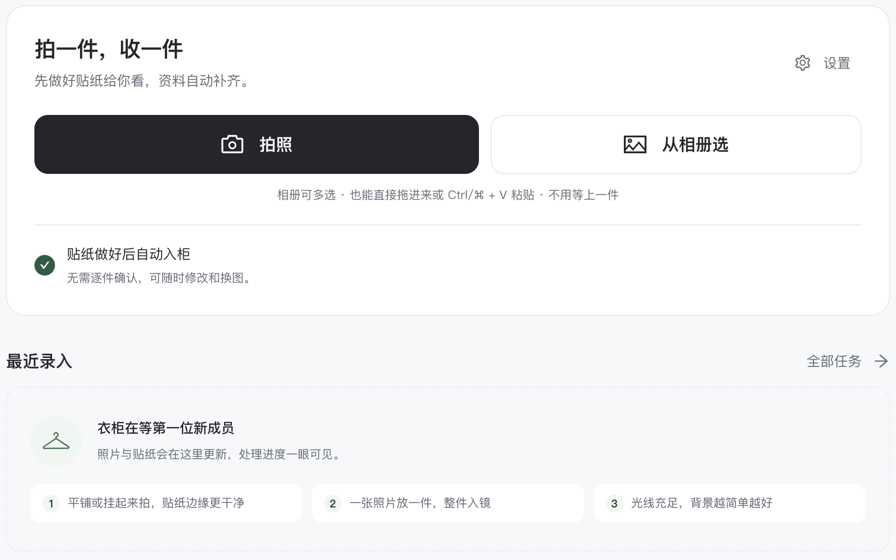

图 5-1 快速入柜

### 5.2 我的衣柜

所有衣物以透明贴纸展示，可按品类、颜色、季节、风格筛选，支持关键词与以图搜图。翻页条固定在屏幕底部，可调每页件数、用键盘翻页；衣物详情支持上一件 / 下一件，手机端左右滑动切换。

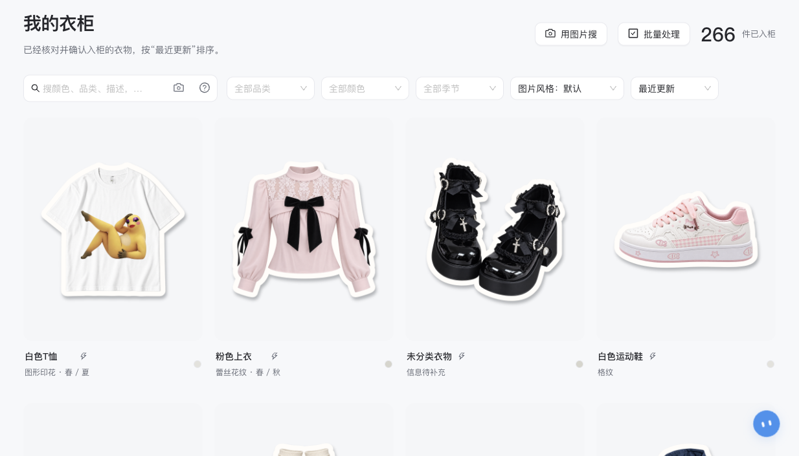

图 5-2 我的衣柜

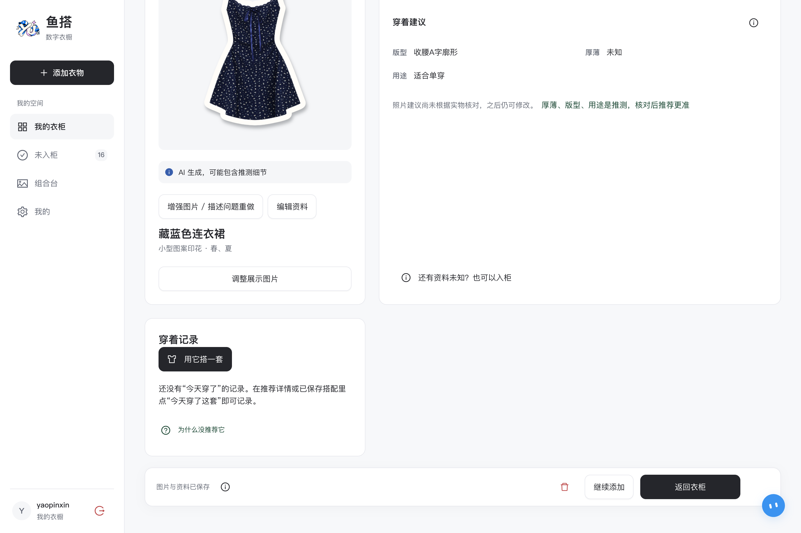

图 5-3 衣物详情：属性、穿着记录与搭配建议

### 5.3 今天穿什么

在“今天穿什么”标签页中，用户选择场景（日常、通勤、约会、运动、户外……）、温度与风格词，系统给出若干套推荐；“我的搭配”顶部也会显示一套今日推荐。

图 5-4 今天穿什么（10-15 截图；10-18 起改为页内标签页）

点开一套推荐，可以看到每件单品的命中项（季节、风格、正式程度、近期是否推荐过）、整体得分和“为什么排这里”。

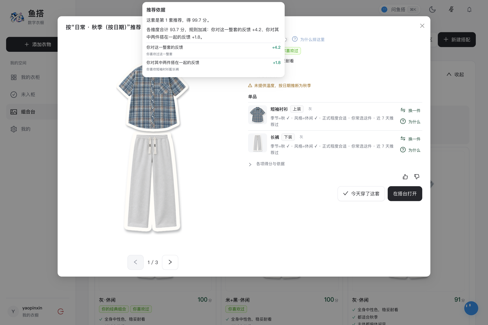

图 5-5 推荐依据：分项合计 93.7 分，规则加减来自用户自己的反馈

只想换双鞋？点“换一件”，系统重新计算该位置的替代品，并标出每个候选的分数变化。

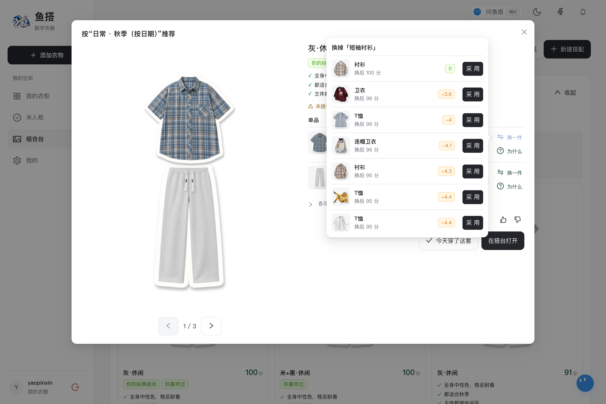

图 5-6 换一件：同位置替代品及分差

### 5.4 穿搭画像

用户的喜好、冷却中的组合、个人偏移都可在设置页查看，并能逐项恢复或一键清空。

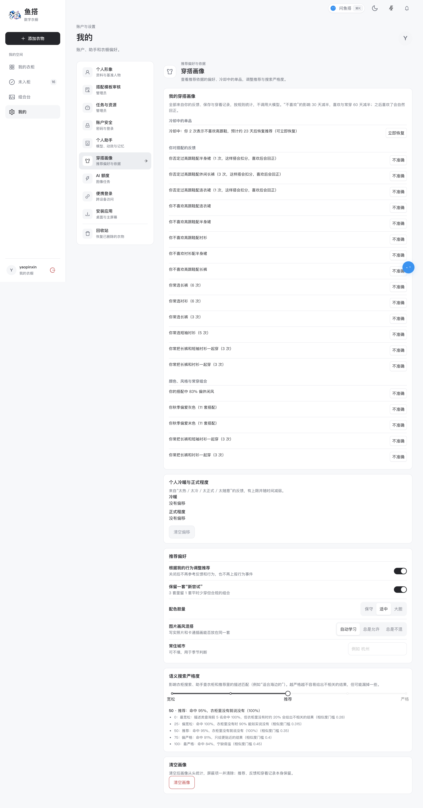

图 5-7 可见、可恢复的穿搭画像

### 5.5 多画板搭台

画板（默认画板、自建画板、Agent 临时画板）与组合台分层：助手生成的方案落在临时画板，不污染用户自己的画板，过期且没有未保存草稿时自动清理。组合台支持图层、等比布局、旋转缩放和导出；保存冲突时会另存为新搭配，不丢失编辑。

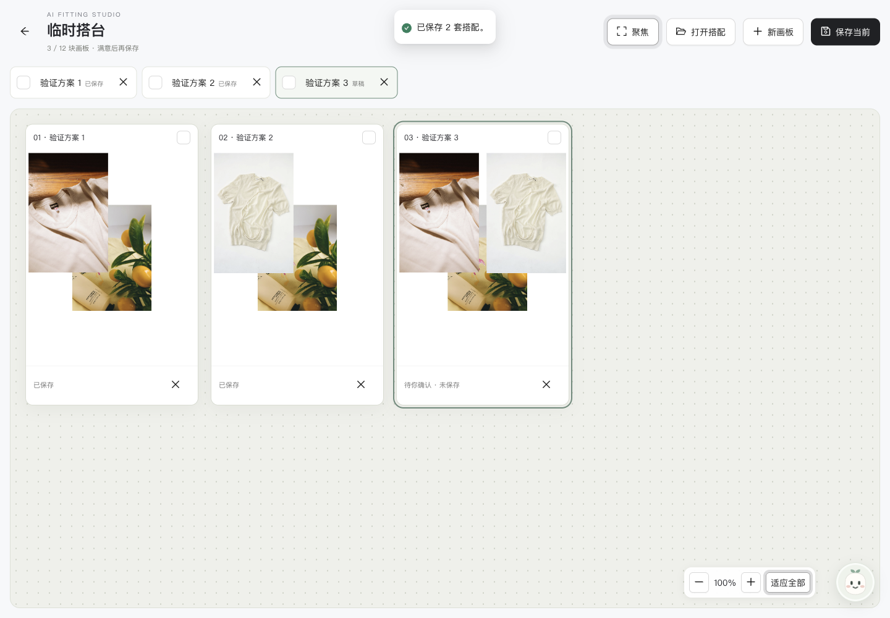

图 5-8 多画板搭台总览

### 5.6 全局助手

右下角表情球唤起助手，面板覆盖在主布局右侧。助手能回答衣柜统计、给出推荐卡片、在授权后操作画板，也能根据版本化帮助文章回答平台用法；涉及敏感记忆、覆盖或付费生成时会单独请求确认。

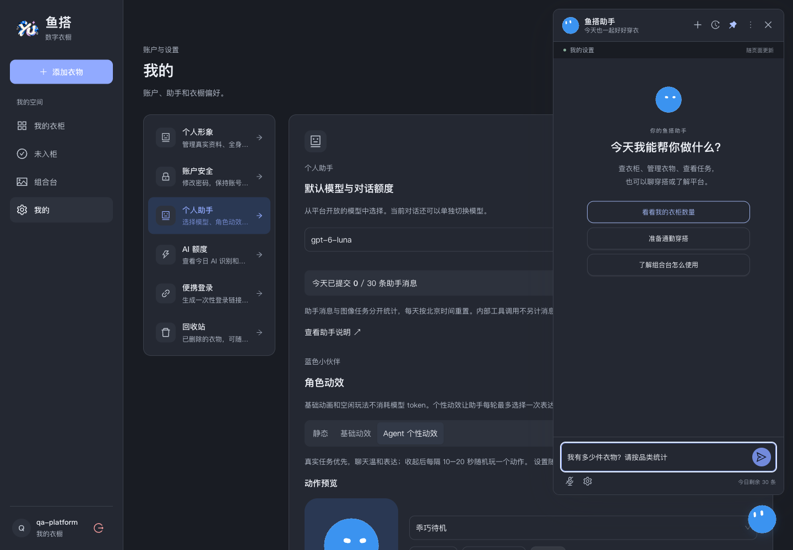

图 5-9 全局助手（深色主题）

### 5.7 个人 OOTD

选择已确认的基准模特和已保存的搭配，系统先做免费的结构检查（例如提示“没有鞋”），再展示参考图、模型、参数与额度，用户确认后才提交。可选 8 个预设动作或自建动作卡；生成后可在五个维度（整体、肩宽、腰围、臀围、腿长）微调身材，生成新图而不改原图和个人资料。

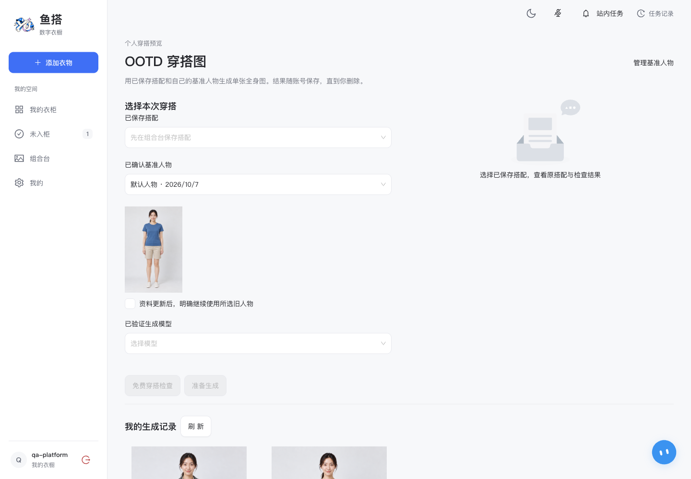

图 5-10 OOTD 页面与生成记录

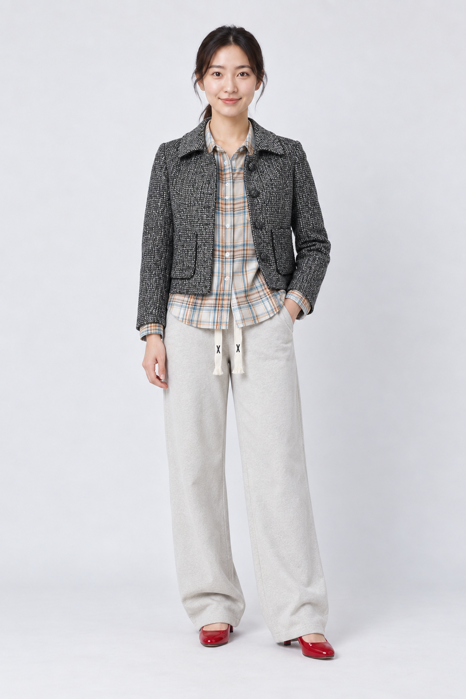

图 5-11 四件衣物的 OOTD 生成示例（隔离测试合成图，用于观察整体效果，不代表真实合身）

### 5.8 管理员：搭法模板审核

搭法模板必须经管理员审核才会进入推荐引擎。审核页列出每个位置的约束、具体物件描述、适用人群与季节。

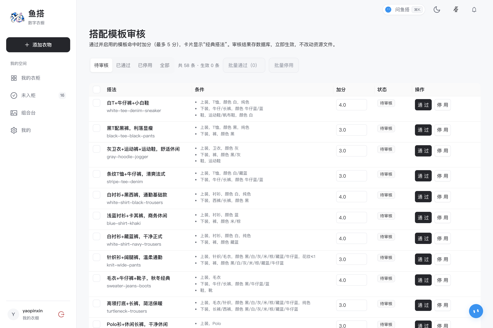

图 5-12 搭法模板审核

## 第六章 测试报告

### 6.1 测试目的

验证鱼搭的功能正确性、推荐质量的底线、隐私与权限边界，以及在服务重启、上游失败、重复提交等异常情况下的可靠性；同时用离线实验评估算法改进的效果。

### 6.2 测试环境

| 项目 | 配置 |
|---|---|
| 硬件 | Apple M5，16 GB 内存 |
| 操作系统 | macOS 26.5.1 |
| 后端 | OpenJDK 21.0.11、Apache Maven 3.9.16、Spring Boot、H2（测试时独立数据库） |
| 用户端 | Node.js 24.18.0、TypeScript、Node 内置测试运行器 |
| 本地模型 | U²-Net、BGE、Chinese-CLIP 的 ONNX 权重（真实模型相关测试在权重存在时运行） |
| 浏览器 | Chromium（Playwright 驱动的真实浏览器验收） |
| 运行日期 | 2026-10-18（自动化测试） |

### 6.3 测试方法

| 类型 | 内容 |
|---|---|
| 单元测试 | 评分器、颜色科学、风格画像、分词器、指纹、反馈衰减等纯计算逻辑 |
| 接口 / 集成测试（白盒） | 启动完整 Spring 应用与独立数据库，经真实 HTTP 调用验证接口、权限、事务与恢复 |
| 守护测试 | **好坏搭配考试题**（`GoldenOutfitsTest`，好搭配必须胜过坏搭配，失败时先判断题与规则谁错，不得删题）；规则表完备性；管理接口契约与包依赖 |
| 离线仿真实验 | 28 天曝光模拟、评分区分度、语义检索与填位标定 |
| 真实浏览器验收（黑盒） | 各里程碑在本地站点逐页操作，保存截图与验收报告 |

### 6.4 测试结果概览

| 范围 | 测试类 / 文件 | 用例数 | 通过 | 失败 | 跳过 |
|---|---:|---:|---:|---:|---:|
| 后端（`mvn test`） | 114 | 572 | 559 | 3 | 10 |
| 用户端（`npm test`） | 25 | 105 | 105 | 0 | 0 |

**说明**：

- 10 项跳过的测试需要真实上游模型密钥或外部服务（例如真实识图模型、S3 兼容服务、模型审美复核），在无密钥环境中按设计跳过。
- 3 项失败与本机运行环境有关，正在复核，不影响上表其余结论：
  - `ManagementOpsKpiApiTest`：测试期望“Agent 运行时不可达”，而测试机上正在运行的服务让它可达；同时本机磁盘占用 93% 触发了额外的磁盘告警；
  - `ClipRealModelParityTest`：本机的 int8 量化 Chinese-CLIP 文本向量与参考值余弦为 0.853，低于 0.95 门槛（fp32 版本不受影响），需核对本机权重版本；
  - `SimilarGarmentApiTest`：标记“不是重复”后的说明文字断言未通过，疑与本机已加载的图像向量模型相关，待在干净环境复测。

### 6.5 测试用例（节选）

| 编号 | 模块 | 测试内容 | 预期结果 | 结果 |
|---|---|---|---|---|
| T01 | 推荐 | 17 组好搭配对坏搭配（`GoldenOutfitsTest`） | 每组好搭配得分高于坏搭配 | 通过 |
| T02 | 推荐 | 连衣裙较多的衣柜连续推荐四周（`ExposureBalanceTest`） | 连衣裙被轮换使用；均衡不推出坏搭配；必选衣物不被限流；同日同意图结果一致 | 通过 |
| T03 | 推荐 | 规则表完备性（`AestheticRulesTest`） | 颜色对、材质对每格都有结论；各场景权重合计 100 | 通过 |
| T04 | 风格画像 | 多巴胺 / 甜美 / 千金反例（`StyleLooksTest`） | 黑白不算多巴胺；千金不等于洛丽塔或女仆；关闭开关回到旧行为 | 通过 |
| T05 | 反馈 | 一次不喜欢的衰减与恢复（`FeedbackLayersTest`） | 落到三个层次、30 天减半；之后的喜欢能拉回；个人偏移有上限且可清空 | 通过 |
| T06 | 检索 | 颜色与品类硬条件（`SemanticSearchTest`） | 衣柜没有的颜色返回空；无编码器时降级为关键词 | 通过 |
| T07 | 检索 | 未识别衣物（`UnrecognizedSearchTest`） | 按图片推测的结果明确标注；看不清的图片不乱认 | 通过 |
| T08 | 相似 | 视觉指纹（`ImageFingerprintTest`） | 同图同指纹；缩放影响小；带色条的 T 恤不判为重复 | 通过 |
| T09 | 入柜 | 上传幂等与恢复（`QuickIntakeServiceTest`） | 相同编号不重复入柜；内容变化拒绝重放；已删除衣物不会被后台任务复活 | 通过 |
| T10 | 任务 | 重启与限流（`ProcessingInfrastructureTest`） | 未派发任务重新排队；已派发任务标为未知且不重放；429 退避在重启后仍有效 | 通过 |
| T11 | OOTD | 冻结输入与单次派发（`PersonalRendersTest`） | 准备免费、提交需具体确认；同一计划只派发一次；删除墓碑防止恢复 | 通过 |
| T12 | OOTD | 多模特、动作与重新生成（`ModelsPosesAdjustmentsTest`） | 多个模特互不影响默认；动作写入提示词；身材调节生成新图；被打断的任务只能手动重新生成一次 | 通过 |
| T13 | 隐私 | 动作提取未成年检查开关（`PoseMinorCheckSwitchTest`） | 开关关闭时照常建卡；打开时拒绝 | 通过 |
| T14 | 助手 | Agent 接口（`AgentApiTest`，27 项） | 账号隔离、CSRF、额度幂等；工具需归属与同意；SSE 不泄露凭据；撤销的记忆不进入运行时 | 通过 |
| T15 | 安全 | 登录与便携登录（`ClosetAuthenticationApiTest`） | 首次登录须改密；便携链接单次使用、并发兑换只有一个成功、可撤销 | 通过 |
| T16 | 管理 | 可插拔架构（`ManagementArchitectureTest`） | 核心包从不依赖管理包；所有管理 bean 受开关控制 | 通过 |
| T17 | 存储 | 本地与 S3 迁移（`StorageMigrationTest`） | 只迁移图片、可重复执行；校验能发现缺失或变化的对象 | 通过 |
| T18 | 用户端 | 工作区注册（`workspace-registry.test.ts`） | 记住上次画板；清理过期 Agent 画板但保留有未保存草稿的画板 | 通过 |

### 6.6 算法实验结果

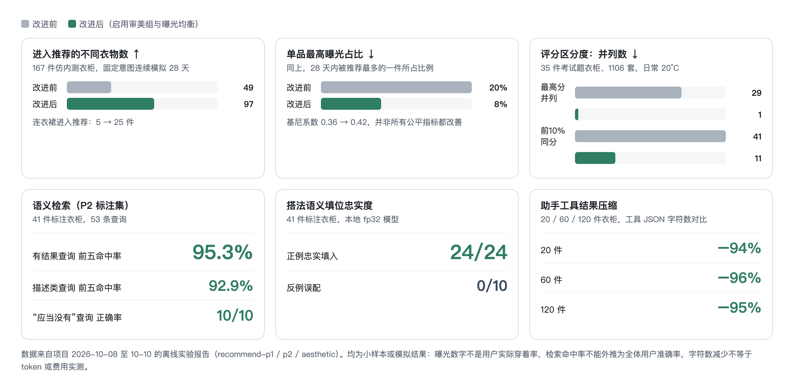

图 6-1 推荐与检索离线实验结果

启用审美组与曝光均衡后，28 天模拟中进入推荐的不同衣物从 49 件增加到 97 件，连衣裙从 5 件增加到 25 件，单品最高曝光占比从 20% 降到 8%；评分最高分并列从 29 套降到 1 套。这些是小样本和模拟结果：曝光不等于用户真实穿着，检索命中率也不能外推为全体用户的准确率。

### 6.7 测试结论

核心推荐、检索、入柜、任务恢复、生成确认、权限与隐私边界的自动化测试通过；三项环境相关失败已定位方向，待在干净环境复核。下一步计划开展 30–50 人、为期四周的共创测试，度量录入耗时、推荐采纳率、理由可信度与四周实际穿着覆盖。

## 第七章 创新点

1. **推荐交给可解释的代码，对话交给模型。** 召回、组合、打分、换一批、换一件、搜索、取色全部零模型调用；每套推荐都能拆成 11 个维度分和具体规则命中，并能回答“为什么没推荐那件”。这既让结果可复现、可审查，也显著减少外部模型调用。

2. **能听懂中文风格词的风格画像。** 18 个画像把“千金”“多巴胺”“新中式”等词拆成颜色、CIELAB 色调、图案、面料、版型线索，按面积加权计算吻合度，用反例测试防止“标签一致就算符合”。

3. **把曝光均衡写进推荐算法。** 动态召回、曝光债、跨天限流与主体多样化，让推荐在保证质量的前提下覆盖更多已有衣物；在模拟中把进入推荐的衣物数翻倍，回应“衣服很多却总穿那几件”。

4. **知识模板与本地语义检索结合。** 已审核的搭法以“具体物件描述”写成，再由本地向量去用户衣柜里语义填位，只有忠实度达标才算该搭法——把搭配知识变成可执行、可审核的约束。

5. **助手的“完成”以浏览器回执为准。** 后端授权、SSE 命令、浏览器执行、带版本号的 ACK 回执；用户可随时停止并接手。解决了 AI 助手“嘴上说完成、界面没变化”的问题。

6. **面向真实 AI 产品的可靠性设计。** 三资源池公平调度、共享账户限流、冻结生成输入、幂等键、结果未知不自动重发但允许用户手动重来——针对限流、耗时与重复计费风险形成完整机制。

7. **隐私与可控性内建。** 推荐不向模型发送衣物完整资料、性别、身材；画像可见可清空；管理接口可插拔且只输出去标识数据。

> 说明：U²-Net、BGE、Chinese-CLIP、ONNX、LangGraph、k-means、DCT 感知哈希等是已有技术。项目的贡献在于领域规则与算法组合、反馈机制、人机协作执行和工程闭环，而非训练新的基础模型。

## 第八章 应用价值

### 8.1 帮用户“穿好已有的衣服”

鱼搭的核心价值是帮助用户理解和使用自己的衣柜：快速找到适合今天的一套，让被遗忘的衣物重新进入选择。这与“减少不必要的购买、延长衣物使用周期”的可持续理念一致；实际减少了多少消费，需要后续用户研究验证。

### 8.2 降低决策成本，同时保留用户的主导权

推荐给出依据而不是命令；用户可以换一件、换一批、在画板上自由调整；所有偏好可见、可恢复、可清空。系统辅助决策，不替用户做决定。

### 8.3 可控的 AI 成本

页面推荐完全不依赖远程大模型；只有聊天、识图与生图按需调用，且生图必须经用户确认。对平台运营者而言，单位用户成本更可预测。

### 8.4 可扩展的部署与商业路径

单机即可完整运行，也可将图片迁到对象存储；管理接口为将来的机构工作台（如服装院校、造型工作室）预留了去标识的数据出口。基础功能免费、持续订阅与 OOTD 生成额度是待验证的商业方案。

## 第九章 总结与展望

### 9.1 总结

鱼搭围绕“已有衣物怎么穿”这一日常决策，完成了从拍照入柜、混合检索、算法推荐、多画板编辑到个人 OOTD 预览和反馈调整的完整闭环。项目坚持“能用代码算的不调模型”：推荐引擎以结构底线、11 维审美评分、中文风格画像和曝光均衡为核心，每一个结论都有依据；大模型被限定在理解语言、识别图片和生成效果图三个用途上。工程上，持久任务、资源许可、冻结输入和回执机制让 AI 功能在限流、中断和重复提交下依然可靠。

后端 572 项、用户端 105 项自动化测试和多轮真实浏览器验收为这些设计提供了证据；好坏搭配考试题、规则完备性和契约测试守护着推荐质量与架构边界。

### 9.2 已知不足

- 推荐质量依赖衣物属性的准确性，识别错误需要用户修正；
- 生成图存在衣物细节漂移，只能作为效果预览，不能代表真实合身；
- 本地模型占用内存，单机 H2 有明确的规模边界；
- 社交、购物导入、日历规划等能力尚不及成熟竞品；
- 审美规则尚未在大规模真实用户中验证。

### 9.3 下一步计划

| 阶段 | 内容 |
|---|---|
| 近期 | 在干净环境复核三项环境相关测试；手机端交互继续打磨；更新路演材料与演示视频 |
| 1–2 个月 | 30–50 人、四周共创测试：录入耗时、推荐采纳率、理由可信度、实际穿着覆盖、外部调用成本 |
| 中期 | 根据真实反馈拟合规则权重；穿搭日历与旅行打包；扩展风格画像 |
| 长期 | 评估数据库与容量扩展；机构工作台（授权服务，不出售用户数据） |

## 附录 术语与资料来源

### 术语

| 术语 | 含义 |
|---|---|
| OOTD | Outfit Of The Day，今日穿搭效果图 |
| 基准人物 / 模特 | 用户确认的人物形象，作为生成 OOTD 的参照 |
| 搭法（模板） | 管理员审核的搭配知识，按位置描述具体物件 |
| 曝光债 | 衣物近期被展示得越少，积累的“应被看到”的权重越高 |
| UNKNOWN | 请求已发给上游但没有收到结果的任务状态，不自动重发 |
| ACK | 浏览器执行画板命令后回传的执行回执 |
| CIELAB | 接近人眼感知的色彩空间，用于测量明度、彩度与色差 |
| ONNX | 开放的神经网络模型格式，可在本地 CPU 上推理 |

### 资料来源

- 推荐总设计、审美实现、风格画像、多模特与动作等设计文档：`smart-closet-server/docs/design/`
- 离线实验报告：`smart-closet-server/reports/`（recommend-p1、recommend-p2、recommend-aesthetic）
- 竞品信息：Acloset、Whering、Stylebook 官方网站（核查于 2026-10-13）
- 竞赛整理材料：本仓库 01–08 篇；图表源文件见 `作品介绍文档/figures-src/`
